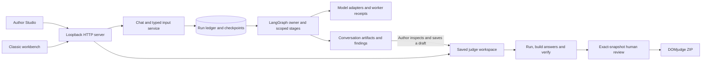

# Architecture

Author Studio is the default single-user local interface. It shares package
tools with the classic workbench. A conversation and a judge package have
separate identities, linked after the author chooses where saved files belong.

## Conversation and authority

[`engine/chat.py`](../engine/chat.py) exposes durable chat turns and artifacts.
[`engine/decisions.py`](../engine/decisions.py) interprets requests under the
model budget. [`engine/input_service.py`](../engine/input_service.py) admits
effects using host authority and scoped grants. The engine stores author
corrections and decisions with their source turns and can mark dependent
evidence stale when the goal changes.

[`engine/owner.py`](../engine/owner.py) coordinates one graph writer per run.
[`engine/graph.py`](../engine/graph.py) selects a scoped collaboration,
investigation, editing or review stage. [`engine/store.py`](../engine/store.py)
persists the inbox, receipts and revisions. Investigation results cite the
candidate and the case actually checked. The independent oracle produces the
expected result for the supported profile.

## Workspace and export

[`studio.py`](../studio.py) links a conversation to a package and manages naming
and editor tools. [`workspace.py`](../workspace.py) owns saved paths, file
hashes, the change journal and review baselines. [`verify.py`](../verify.py)
runs the selected sources and checks the saved package. Its report records the
snapshot it verified. [`package_workflow.py`](../package_workflow.py) evaluates
whether that snapshot can be reviewed or exported.

An agent artifact is available for inspection in chat. Copying it to the
workspace stages a draft. Saving checks the source and destination versions.
Human approval applies to the saved snapshot, and subsequent changes require
new verification and approval. This workspace path exports the ZIP today.
The engine's V3 stage handoff has its own completion contract. Engine-level
delivery and restore are on the V5 roadmap.

## Recovery and operating modes

Browser drafts can be recovered independently of package files. A local job
request ID allows the browser to observe the same server job after losing a
response. The local job registry lives in the server process. Saved package
files, review snapshots and the engine ledger live on disk.

The named sample uses scripted chat and simulated worker receipts. A configured
investigation can use a provider and an isolated worker. The local workspace
runner and verifier report their own evidence. See the
[state-machine inventory](architecture/state-machines.md) and
[scope of the recorded checks](README.md#verification-and-roadmap).
