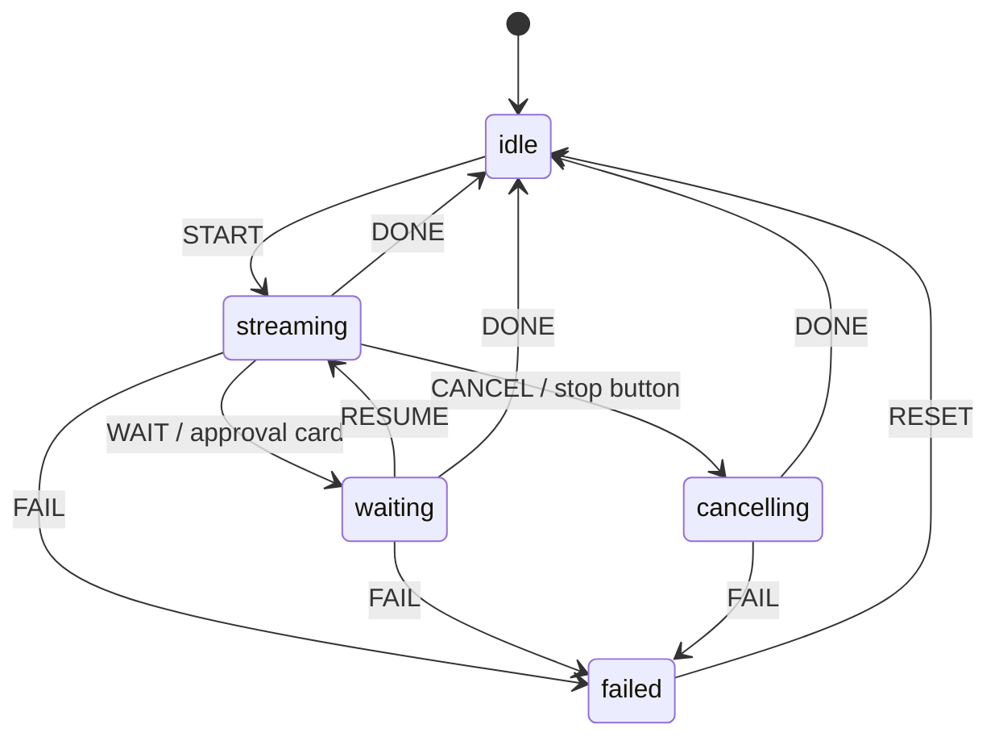
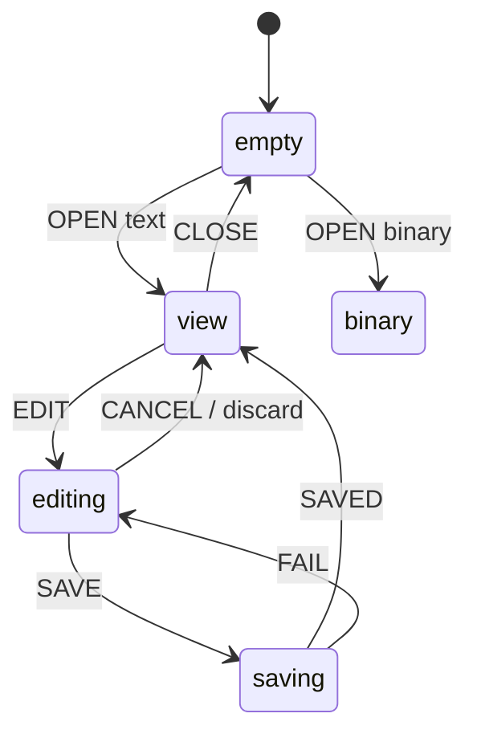
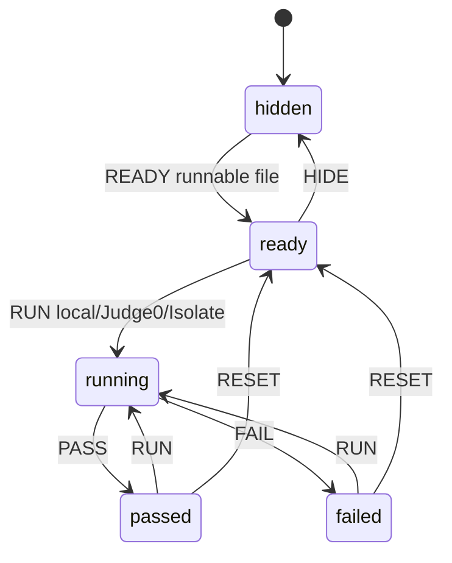
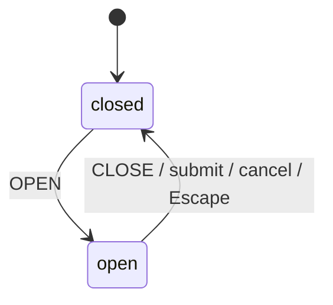

# UI state machines

The workbench grew around a handful of nullable fields and booleans:

```js
state.jobId, state.jobChatId, state.pendingApproval, state.pendingMessage,
state.fileBusy, state.dirty, state.fileMode, state.follow,
state.activeTab, state.activeSide, state.approvalRendered, ...
```

Each screen also has local DOM state (`hidden`, `disabled`, `innerHTML`) and
server state (`job.state`, `summary.lastStatus`, `changes[].reviewed`). That is
an implicit state machine spread across four places. It makes illegal states
representable, forces every handler to repeat guards, and leaves browser/agent
automation with no stable way to ask "what is the app doing?".

This document is the inventory and the decision. `web/machines.js` is the
first, deliberately additive implementation. The migration tasks and target
machine set are in
[`plans/ui-ux-ax-rework/03-ARCHITECTURE.md`](plans/ui-ux-ax-rework/03-ARCHITECTURE.md)
and [`plans/ui-ux-ax-rework/04-TASKS.md`](plans/ui-ux-ax-rework/04-TASKS.md).

## Decision

Use a **small, dependency-free finite-state-machine layer** owned by the web
client:

- one transition table per concern, with named states and events;
- one writer per concern (`send(event)` / `set(state)` for server restores);
- UI is derived from the machine state (buttons, disabled, hints, live text);
- side effects live at the edge (fetch, poll, focus) and are triggered by a
  transition, not by ad-hoc booleans;
- every machine mirrors its state to `data-state-<id>` and
  `window.__AUTHOR_AGENT__`, so accessibility tooling and the agent can observe
  the same truth as the user;
- illegal events warn in development and are ignored, never thrown at the user.

Why not XState or a reducer framework: the app is a classic-script, no-build
frontend with one large `app.js`; adding a runtime and a migration of every
field at once would be a rewrite with a high regression risk. The custom layer
is ~150 lines, testable in the browser and Node, and can be adopted screen by
screen. The transition tables are the durable part; the implementation can be
replaced later without changing the UX contract.

Why not keep deriving from `jobId`/booleans: the current bugs are exactly the
cost of that approach. A long chat pushed the composer and run panel out of the
viewport, native prompts bypassed the app's focus and styling model, and job
guards are duplicated in `sendMessage`, `runToolJob`, `newChat`, `selectChat`
and every button's `disabled` expression. Each new screen adds another copy.

## Current inventory

| # | Machine | Implicit fields today | States | Events | Priority |
|---|---------|-----------------------|--------|--------|----------|
| 1 | Connection | `setConnection`, fetch failures | unknown, online, offline | `ONLINE`, `OFFLINE` | done |
| 2 | Session | `state.slug`, `summary`, load errors | no-workspace, loading, ready, error | `LOAD`, `READY`, `ERROR`, `RESET` | done |
| 3 | Turn / job | `jobId`, `jobChatId`, `jobEvents`, `pollTimer`, server `job.state` | idle, streaming, waiting, cancelling, failed | `START`, `WAIT`, `DONE`, `FAIL`, `CANCEL` | done |
| 4 | Approval | `pendingApproval`, `approvalRendered`, interrupt `id`s | none, pending, resolved | `ASK`, `RESOLVE`, `CLEAR` | done |
| 5 | Editor | `file`, `dirty`, `fileMode`, `fileBusy` | empty, view, editing, saving, binary | `OPEN`, `EDIT`, `SAVE`, `SAVED`, `FAIL`, `CANCEL`, `BINARY`, `CLOSE` | done |
| 6 | Run panel | `run-panel.hidden`, `fileBusy`, output class | hidden, ready, running, passed, failed | `READY`, `RUN`, `PASS`, `FAIL`, `CANCEL`, `HIDE`, `RESET` | done |
| 7 | Modal | `<dialog>.open`, native `prompt`/`confirm` | closed, open | `OPEN`, `CLOSE` | done for action dialog |
| 8 | Chat selection | `chats`, `chatId`, `chatQuery`, `openTabs` | no-chat, loading, loaded, error | `SELECT`, `NEW`, `RENAME`, `DELETE`, `LOAD`, `ERROR` | next |
| 9 | Verification / export | `summary.lastStatus`, `stale`, `unreviewed`, `export-btn.disabled` | unverified, verifying, verified, failed, stale | `VERIFY`, `PASS`, `FAIL`, `STALE`, `REVIEW`, `EXPORT` | next |
| 10 | File load | `state.file`, `dirty`, tree row | none, loading, loaded, stale, error | `LOAD`, `READY`, `ERROR`, `STALE` | next |
| 11 | Changes / review | `changes[]`, `unreviewed`, `selectedChange` | clean, unreviewed, reviewing, reverted, conflict | `CHANGE`, `REVIEW`, `REVERT`, `CONFLICT`, `CLEAR` | next |
| 12 | MCP consent | `mcp` DOM, `data-mcp-tool`, `mcpSave` | disabled, enabled, dirty, saving, probing | `GRANT`, `REVOKE`, `SAVE`, `PROBE`, `ERROR` | later |
| 13 | Settings | form values, `key-status`, save toast | clean, dirty, saving, saved, error | `EDIT`, `SAVE`, `SAVED`, `ERROR`, `RESET` | later |
| 14 | Mentions | `mentionQuery`, menu `hidden` | hidden, open, filtered, picked | `TRIGGER`, `FILTER`, `PICK`, `CLOSE` | later |
| 15 | Follow / scroll | `state.follow`, `follow-btn.hidden`, scroll listener | following, paused | `PAUSE`, `FOLLOW` | later |
| 16 | Tree selection | `expanded`, `state.file`, row DOM | collapsed, expanded, selected | `TOGGLE`, `SELECT`, `REFRESH` | later |
| 17 | Test tabs | `samples`, `activeSample`, `testResults` | empty, running, pass, fail | `LOAD`, `RUN`, `PASS`, `FAIL`, `SELECT` | later |
| 18 | Checkpoint restore | `history` buttons, native `confirm` | idle, confirming, restoring, done, error | `ASK`, `RESTORE`, `DONE`, `ERROR` | later |

States marked **done** already have a definition in `web/machines.js` and are
mirrored during the normal UI flow. The rest are documented now and migrate
without changing the public UX.

### Turn / job



Rules that become enforceable:

- one turn per workspace: `streaming` and `waiting` both lock chat switching,
  new chats and second sends;
- `waiting` is the only state that renders approval/clarification cards;
- `cancelling` disables Stop and shows "stopping...";
- a queued message (`pendingMessage`) only sends on `idle`, never on `waiting`;
- `jobChatId` is part of the transition payload, not a separate nullable field.

### Editor



Rules that become enforceable:

- `saving` blocks a second Save and a file switch;
- `editing` is the only state that can be dirty;
- `CANCEL` is only legal from `editing`, so a read-only file never asks
  "discard?";
- a failed save returns to `editing` with the buffer intact.

### Run panel



The three backends share one visible lifecycle. The machine does not care
whether the result came from `/run`, `/judge0/run` or `/isolate/run`; the edge
stores the backend in the transition detail.

### Session / verification

```mermaid
stateDiagram-v2
  [*] --> no-workspace
  no-workspace --> loading: LOAD
  loading --> ready: READY
  loading --> error: ERROR
  ready --> loading: LOAD
  ready --> unverified: no report
  ready --> verified: report verified and not stale
  ready --> failed: report failed
  ready --> stale: workspace changed after report
  stale --> verifying: VERIFY
  unverified --> verifying: VERIFY
  verifying --> verified: PASS
  verifying --> failed: FAIL
```

Export is derived: only `verified` **and** every change reviewed enables it.
This is already the behaviour, but today it is encoded in
`updateExportButton()` and `renderSummary()` independently. The machine makes
it one predicate.

### Modal



Native `<dialog>` supplies focus trapping, Escape, backdrop and focus return.
The action dialog adds a promise API, inline validation and destructive styling.
All `window.prompt`/`window.confirm` calls in `web/app.js` are gone.

## Cross-cutting invariants

These are properties, not states. They should be asserted in tests and in
development builds:

1. **One writer per concern.** Only the turn machine may set `jobId`; only the
   editor machine may set `dirty`; only the modal machine may call
   `showModal()`.
2. **No second turn.** `streaming`, `waiting`, `cancelling` ⇒ chat switch, new
   chat, second send and file run are disabled.
3. **Approval precedence.** `pendingApproval.length > 0` ⇒ composer disabled
   and approval card visible; a clarification is an approval interrupt.
4. **Dirty buffer is never lost.** Leaving `editing` requires `CANCEL` through
   the action dialog, or a successful `SAVE`.
5. **Export is a derived gate.** Verified + not stale + zero unreviewed
   changes. No handler sets `export-btn.disabled` by hand.
6. **One visible modal.** `modal.open` implies the previous dialog is closed
   and focus is inside; on close focus returns to the invoker (or a safe
   fallback).
7. **Every async edge has a terminal state.** Fetch/poll paths always end in a
   success or error state; no "spinner forever" state.
8. **Server truth wins on restore.** `set()` is only for hydration/workspace
   switches; a conflicting server report transitions through `STALE`, not by
   mutating DOM classes.

## AX contract

Accessibility and agent experience need the same observability:

- `document.body[data-state-turn]`, `[data-state-editor]`,
  `[data-state-run]`, `[data-state-modal]`, `[data-state-session]`,
  `[data-state-connection]`, `[data-state-approval]`;
- `document.body[data-panel]` and `[data-side]` for the inspector/sidebar;
- `window.AuthorMachines.snapshot()` returns a serialisable object;
- `window.__AUTHOR_AGENT__` is updated on every transition with
  `{state, previous, event, at}`;
- the conversation remains `role="log"` with `aria-live` set by the app, and
  the composer keeps an explicit `aria-label`;
- the action dialog uses `aria-labelledby="action-title"` and
  `aria-describedby="action-desc"`, inline `role="alert"` errors, and returns
  focus to the invoking control;
- all icon-only buttons have an `aria-label` that includes the object name
  ("Rename Claim chat", "Delete Claim chat"), not just "Rename".

This lets a CDP/e2e harness assert the same states a screen reader user hears,
without reaching into private variables.

## DX contract

`web/machines.js` exports:

```js
AuthorMachines.machines.turn.send("START");
AuthorMachines.machines.editor.can("SAVE");   // false in view
AuthorMachines.machines.run.set("ready");     // hydration only
AuthorMachines.snapshot();                    // { turn: "streaming", ... }
```

- Illegal events warn with the machine, state and event, then return `false`.
- `set()` is for restoring server/workspace state and never invents a
  transition.
- New screens add a definition and a test; they do not add another nullable
  boolean.
- The transition tables are the review surface. A PR that adds a state without
  an event is a design smell and should be rejected.

## Migration plan

**Phase A (done, this change).**
Add `web/machines.js`; mirror connection, session, turn, approval, editor, run
and modal; replace every native prompt/confirm; add `qa/layout_regression.ps1`.

**Phase B (next).** Move chat selection and file loading into machines. Delete
`approvalRendered`, `pendingMessage`, `jobEvents` and `fileBusy` in favour of
machine state plus payload. This removes the duplicated guards in
`sendMessage`, `runToolJob`, `newChat` and `selectChat`.

**Phase C.** Move verification/export and changes/review. `updateExportButton`
and `renderSummary` become pure selectors. Add a `STALE` event on every agent
write instead of recomputing stale in three places.

**Phase D.** Move MCP consent, settings, mentions, follow and test tabs. These
are lower risk and mostly local to one panel.

**Acceptance for every phase**

- all existing `qa/test_*` suites, axe, AX-tree, CDP workflow and the new
  layout regression stay green;
- one new browser test per machine asserting an illegal event is a no-op and a
  legal event updates the visible control;
- no increase in `app.js` top-level state fields; the count should fall;
- a manual keyboard pass: Tab to every new control, Enter/Space activates,
  Escape closes a dialog, focus returns to the invoker.
