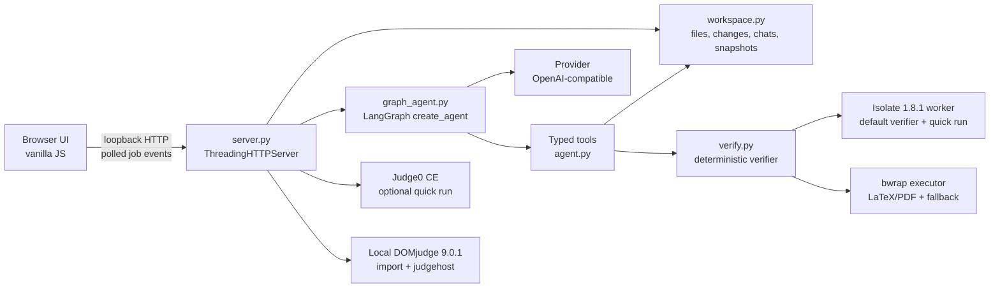

# Technical deep dive

This document is the presenter's technical backup for the ICPC Author Agent.
It explains the architecture, the decisions behind it, exactly what each test
covers, and the follow-up questions a technical audience is likely to ask.

It is written to be defensible. Where something is not covered, it says so.

---

## 0. The one-slide version

> The agent does the authoring work. The deterministic verifier decides whether
> the package is correct. Export is a three-part gate: verified, unchanged, and
> reviewed. A verified package imports into local DOMjudge 9.0.1 and is judged
> by a real judgehost with AC / WA / TLE.

Three claims, three proofs:

| Claim | Proof |
|---|---|
| The agent can author a real package | `sum-test` is verified with 6 tests, validator, reference, negative solution, PDF and 18/18 ICPC spec checks |
| The model cannot declare success | `verify.py` compiles and runs the package; export refuses unverified, stale or unreviewed state |
| The output is real | local DOMjudge 9.0.1 import + `judgehost:9.0.1` AC/WA/TLE |

Non-claims: multi-user hosting, a hypervisor VM, contest load, every package
variant, every language, and a manual screen-reader sign-off.

---

## 1. Scope and requirements

The product is a **local single-author workbench**.

Requirements that shaped the architecture:

1. One author, one machine, one provider key.
2. The workspace on disk is the source of truth.
3. Every model action is a typed tool call, never ambient shell authority.
4. Compilation, execution and comparison are the evidence; chat text is not.
5. The exported package must import into DOMjudge without manual repair.
6. Long sessions must survive context limits, restarts and provider failures.
7. The UI must make the work and the evidence inspectable, not hide them.

These requirements rule out a hosted multi-tenant design, an LLM-as-judge
verifier, and a “just ask the model whether it is correct” workflow.

---

## 2. System map



### Container topology

| Service | Image / role | Sees | Port |
|---|---|---|---|
| `author-agent` | `Dockerfile`; UI, server, agent, checkpoints, provider key | `./workspaces`, `./.author-agent` | `127.0.0.1:8787` |
| `executor` | `Dockerfile.executor`; bwrap worker | `./workspaces` only | none |
| `isolate-worker` | `judge0/judge0:1.13.1`; Isolate 1.8.1 | `./workspaces` only | none (internal) |
| `judge0` stack | optional quick-run server/worker/Postgres/Redis | separate | `127.0.0.1:2358` |
| DOMjudge | `domserver:9.0.1`, `judgehost:9.0.1`, `mariadb:11.4` | its own volume | `127.0.0.1:18080` |

The app container is the only place with the provider key. The executor and
Isolate worker never receive it. The browser never receives it either.

### Why the UI is vanilla JavaScript

There is no build step. `web/index.html` loads five scripts: `theme.js`,
`highlight.min.js`, `machines.js`, `dialogs.js`, `app.js`. This keeps the local
install simple and auditable. The tradeoff is a large `app.js` (about 4,600
lines) instead of a component framework; for a single-user local tool that is an
acceptable trade.

---

## 3. One agent turn, end to end

### Request path

1. The browser sends `POST /api/workspaces/<slug>/chat` with the message, chat
   id, mode and selected context.
2. `server.py` checks the `Host` and `Origin`, rejects a second concurrent turn
   for the same workspace, and starts a background job.
3. `graph_agent.run_turn()` calls `_run_turn_async()`, opens
   `AsyncSqliteSaver` on `<workspace>/.agent/checkpoints.sqlite`, and uses the
   chat id as `thread_id`.
4. Before the model call, `_repair_checkpoint()` removes incomplete
   assistant/tool groups left by a crashed or cancelled turn, while preserving
   real HITL pauses.
5. The graph is invoked with only the new user message. The checkpointer
   supplies the history.
6. Middleware runs in this order:
   `PinnedContext` → `Summarization` → `ContextBudget` → `TodoList` →
   `HumanInTheLoop` → `ToolError` → model retry/fallback/refusal/stream checks →
   `ToolRetry` → `ModelCallLimit`.
7. The model emits text and/or typed tool calls. `agent._dispatch()` executes
   them with the workspace slug injected by `InjectedState`; the model cannot
   choose a different workspace.
8. Tool results are bounded, changes are recorded, and events are appended to
   the job. The UI polls `/api/jobs/<id>/events?since=<seq>`.
9. If a tool needs approval, the graph pauses. The interrupt is written to
   `.agent/pending/<id>.json`; the UI resumes with `Command(resume=...)`.
10. The final text, usage and tool events are mirrored to the JSON chat file.
    The SQLite checkpoint remains authoritative for the agent.

### What the model can and cannot do

The registry is explicit (`graph_agent.TOOLS`):

```text
list_files read_file write_file delete_file run_command
build_answers measure_limits verify_package read_report export_package
search_workspace list_tests report_summary update_brief record_decision
set_focus review_package ask_user
list_skills load_skill unload_skill
ask_test_designer ask_verifier_auditor
```

Rules enforced outside the model:

- **Path confinement:** `workspace.resolve()` rejects `..`, absolute escapes and
  writes into `.agent/`.
- **Command confinement:** `run_command` allows only `python`, `python3`, `g++`,
  `gcc`, `javac`, `java`, `pdflatex`, `latexmk`, plus compiled binaries inside
  the workspace. No shell, pipes, redirection or command substitution.
- **Bounded I/O:** file reads/writes are capped at 2 MiB; large reads are
  truncated; tool text is capped; the context guard truncates again.
- **Secret data:** the agent may not read `data/secret/**` or any `.ans` file.
  `list_tests` returns names and counts only. `search_workspace` skips secret
  paths. The pinned-context path also filters secret paths. The UI file picker
  and quick open exclude them. MCP consent keeps them blocked.
- **Export:** `export_package` is not a model decision; it checks the report,
  snapshot and review state.

### Why this matters

A tool result is data, not a command. The system prompt tells the model to treat
statements, comments and stdout as untrusted. More importantly, the *authority*
is not in the prompt: path checks, the command allowlist, the executor boundary
and the export gate are ordinary Python code. Even a fully prompt-injected model
cannot bypass them through text alone.

---

## 4. Verification, end to end

`verify.py` is the heart of the product. `verify(slug, write_answers=False)`:

1. Loads the package (`package_model.load`) and detects interactive problems.
2. Runs structural checks (`_structure`):
   - required files: `problem.yaml`, statement `.tex`, `domjudge-problem.ini`;
   - name, memory limit, time limit;
   - at least one sample and one secret test;
   - at least one accepted reference;
   - at least one negative solution;
   - an input validator.
3. Checks test groups (`package_model.group_errors`).
4. Runs the output-validator self-test if a checker is present
   (`verification_modes.checker_selftest`).
5. **Requires measured limits.** This is a hard gate: `Limits measured` must
   pass. Limits are written by `measure_limits`, not guessed at creation.
6. Compiles every accepted and negative solution.
7. Builds and runs the input validator on **every** test. Valid input must exit
   **42** (ICPC contract). A rejection fails verification with the test name and
   exit code.
8. Runs every accepted reference on every test. The reference must be `AC`.
   With `write_answers=True`, `build_answers` writes the `.ans` files, and
   multiple accepted references must agree; disagreement is reported.
9. Runs every negative solution on every test. A negative must produce at least
   one non-AC verdict. A wrong program that is `AC` everywhere is a **survivor**
   and fails verification. A compile failure is reported but is not counted as a
   successful kill.
10. Scores test groups (`scoring.evaluate`), including dependencies.
11. Compiles the statement with `pdflatex` twice and copies
    `problem_statement/problem.en.pdf` to `problem.pdf`.
12. Runs the ICPC package audit (`icpc_spec.audit`).
13. Writes the report, including the workspace snapshot hash.

### What “verified” means

`verified` means: the package is structurally complete, the validator accepted
every test, every reference matched, every negative was killed, limits were
measured from the reference, the statement compiled, and the ICPC audit passed.

It does **not** mean: the problem is mathematically correct, the tests cover all
cases, or the statement is unambiguous. Those remain human responsibilities.

### Why limits are measured, not chosen

The workspace starts with provisional limits. `measure_limits` runs every
accepted reference on every test and writes the result to `problem.yaml`,
`domjudge-problem.ini` and the statement.

Implementation:

```text
time_limit = clamp(ceil(max_runtime * 5) / 2, 1.0, 10.0)   # 0.5 s granularity
memory_mb  = clamp(ceil(max_rss_mb * 1.5 / 64) * 64, 256, 1024)
```

The 5× time factor is deliberately conservative for a noisy local Windows/WSL
host. The tradeoff is that generous limits make TLE discrimination weaker. A
future version should use repeated runs and a percentile rather than one sample.

### Checkers, interactors, float and groups

- **Output validators:** two contracts are supported: the ICPC spec contract
  (`input answer feedback_dir`, team output on stdin, exit 42/43) and the legacy
  testlib contract.
- **Checker self-test:** reference accepted, wrong rejected, malformed/empty/
  extra output, `data/valid_output`, `data/invalid_output`, crash, timeout and
  accept-all rejection.
- **Interactive:** connected validator/solution pipes, transcript capture,
  wall-clock timeout, reference/negative checks, transcript checker. A forged
  transcript is rejected.
- **Float:** explicit tolerance, NaN/Inf rejection.
- **Groups:** `points` and `dependencies`; a group earns points only when its own
  tests and all dependencies pass.

### Verification cost

The eval workspace `eval-claim-or-concede-2` has 86 tests. The measured run was
**834.1 s**, under the **900 s** verifier budget. The budget is close enough that
long problems need monitoring. `sum-test` verifies in seconds.

---

## 5. Export, end to end

`verify.export_package()` refuses unless all three conditions hold:

1. `lastReport.status == "verified"`;
2. the report's snapshot hash equals the current workspace hash;
3. `workspace.summary(slug).unreviewed == 0`.

The snapshot hash is a SHA-256 over every file path and its bytes, excluding
`.agent/`. This is why editing after verification makes the report **stale** and
blocks export.

The ZIP includes the package roots (`problem.yaml`, `domjudge-problem.ini`,
statement dirs, `data`, `submissions`, validators, groups, generators) and a
`problem_statement/manifest.json` with metadata and per-file hashes.

Text test payloads (`.in`, `.ans`, `.out`, `.interaction`, `.py`) are normalized
to LF inside the ZIP, and the manifest hashes the normalized bytes. This removes
the DOMjudge CRLF warning and makes the archive deterministic across platforms.
A Python validator without a shebang gets one and is written as
`input_validators/validate` to match the ICPC convention.

Export does **not** push to DOMjudge. It produces the ZIP; the local test
scripts import it through the DOMjudge API.

---

## 6. Decision log

| # | Decision | Alternatives | Why | Tradeoff |
|---|---|---|---|---|
| 1 | LangGraph `create_agent` with middleware | Hand-written loop; LangChain AgentExecutor; AutoGen/CrewAI | Explicit state, streaming, checkpointing, interrupts, testable graph | Dependency/API churn; mitigated by a thin adapter and framework-free domain modules |
| 2 | Deterministic verifier is the authority | LLM-as-judge; trust the model's summary | Compilation/execution is a cheap oracle; model self-assessment is not evidence | Verifier is only as good as its checks; see limits |
| 3 | File-based workspace + per-workspace SQLite checkpoints | Relational DB; object store | The package is already a directory; inspectable, copyable, backup-friendly; snapshot hash is trivial | No multi-user query layer or row-level locking |
| 4 | Real Isolate 1.8.1 as default verifier executor | bwrap only; Judge0 only | Real cgroups/rlimits, one box per request, no network, read-only root | Privileged worker with `seccomp=unconfined`; local-only |
| 5 | bwrap for LaTeX/PDF and fallback | Run everything through Isolate | TeX Live and `pdflatex` are easier in the executor image; Isolate is for untrusted code | Two execution paths to maintain |
| 6 | Judge0 as optional quick-run only | Use Judge0 for verification; iframe `judge0/ide` | Quick run is a different job; verification needs a stable argv/workspace/checker contract | Third backend; not the authority |
| 7 | Native run panel, not an iframe | Embed `judge0/ide` | Shares the workspace/file model and avoids a second editor | More UI code |
| 8 | Conservative token counter + hard trim | Trust `count_tokens_approximately` | A 1.3 MB numeric file undercounted by ~3× and caused a 1.12M-token overflow | Over-counts prose; may compact earlier than necessary |
| 9 | Pinned context re-injected every call | Rely on summarization alone | Compaction can erase constraints, decisions and skill state | Extra tokens per call |
| 10 | Per-call HITL approvals | Batch approval | The exact action is shown and bound; duplicate/stale approvals are safer | More clicks in review mode |
| 11 | LF normalization in export | Raw bytes | DOMjudge CRLF warning; deterministic hashes | Rewrites test data in the archive (not the workspace) |
| 12 | Single-user loopback design | Multi-tenant hosted service | Requirements are local; no auth/tenant model needed | Cannot be shared as-is |
| 13 | DOMjudge 9.0.1 + privileged judgehost with `cgroup: host` | Older/newer images; unprivileged judgehost | Reproducible local judging on this WSL host | Privileged local container; no writable temp dir |
| 14 | Monaco 0.44.0 vendored, lazy AMD load, textarea fallback | CDN; build-time bundling | Works offline; CSP-friendly; graceful fallback | Vendor size; loader needs `unsafe-eval` |
| 15 | Limits = ~5× measured runtime | 2×; fixed limits | Conservative on noisy local hardware | Weakens TLE discrimination |
| 16 | Secret-data defense in depth | One guard in the prompt | Prompt injection and accidental reads are both real; multiple independent gates | More code paths to keep consistent |

---

## 7. What is covered by what

Status legend:

- **✅** automated test or recorded evidence; passes
- **◐** implemented, but only indirectly exercised or manually evidenced
- **✗** not covered; a known gap

### 7.1 Authoring workflow

| Requirement | Implementation | Test / evidence | Status |
|---|---|---|---|
| Create an isolated problem workspace with the ICPC/DOMjudge scaffold | `workspace.create()`; `templates/` | Exercised by `qa/test_stale_export.py`, `qa/test_verification_modes.py`, `sum-test` | ✅ |
| The model can only act through typed tools | `graph_agent.TOOLS`; `agent._dispatch()` | `qa/stress_agent.py` | ✅ |
| The model cannot choose another workspace | `InjectedState` slug injection | `qa/stress_agent.py`; code review | ✅ |
| Paths cannot escape the workspace or write `.agent/` | `workspace.resolve()` | `qa/test_security.py` (path traversal, `.agent`) | ✅ |
| Commands cannot use a shell or escape the allowlist | `agent.run_command()`; `META` rejection; `ALLOWED` set | `qa/test_security.py`, `qa/test_executor_security.py` | ✅ |
| Every write is a reviewable change with a diff | `workspace.write_text()`; `changes.json` | `qa/test_phase1.py`, `qa/phase4_evidence.ps1` | ✅ |
| Revert and selective hunk application | `workspace.revert()`, `apply_hunks()` | `qa/test_hunks.py` | ✅ |
| Human approval for export and (optionally) writes/deletes | `HumanInTheLoopMiddleware` | `qa/stress_agent.py` | ✅ |
| Clarification pauses and resumes | `ask_user` + LangGraph interrupt | `qa/stress_agent.py` | ✅ |
| Plan/todo list is mirrored to the UI | `TodoListMiddleware`; per-chat plan file | `qa/stress_agent.py` | ✅ |
| Durable chats and checkpoints across restarts | `AsyncSqliteSaver`; JSON chat mirror | `qa/stress_agent.py`, `qa/test_phase1.py` | ✅ |
| Failed/cancelled turns are saved, not silently dropped | `run_turn` error path; checklist repair | `qa/stress_agent.py` | ✅ |
| Context compaction and hard budget guard | `agent_middleware.py` | `qa/test_context_budget.py`, `qa/test_context_500k.py`, `qa/test_phase1.py` | ✅ |
| Provider retry, fallback, refusal and truncated-stream handling | Middleware | `qa/test_provider_faults.py`, `qa/test_phase1.py` | ✅ |
| Progressive skills, max two active | `skill_registry.py` | `qa/test_skills.py` | ✅ |
| Clarification survives compaction | Pinned context | ◐ no dedicated compaction+clarification test; pinned-context contract tested | ◐ |
| Reviewer / test-designer / verifier-auditor subgraphs | `graph_agent.py` read-only subgraphs | ◐ implemented; no dedicated automated test | ◐ |

### 7.2 Verification

| Requirement | Implementation | Test / evidence | Status |
|---|---|---|---|
| Required structure and metadata | `verify._structure()` | `qa/test_icpc_spec.py`, `qa/test_stale_export.py` | ✅ |
| Validator must accept every test with exit 42 | `verify.verify()` | `qa/test_icpc_spec.py`, `qa/test_verification_modes.py`, `sum-test` 6/6 | ✅ |
| Accepted reference must be AC on every test | `verify.verify()` | `sum-test` report; `qa/test_verification_modes.py` | ✅ |
| Multiple accepted references must agree | `verify.build_answers()` | ◐ implemented; `sum-test` has one reference | ◐ |
| Negative solutions must be killed | `verify.verify()` | `sum-test` negative WA 5/6; `qa/test_verification_modes.py` | ✅ |
| A wrong solution that passes every test fails | `verify.verify()` survivor path | ◐ code path and eval behavior; no dedicated QA test | ◐ |
| Limits must be measured before verification | `verify.measure_limits()`; hard gate | `sum-test`; `qa/test_stale_export.py`; `qa/verification-timing.json` | ✅ |
| Output checker self-test | `verification_modes.checker_selftest()` | `qa/test_verification_modes.py`, `qa/test_testlib.py` | ✅ |
| Interactive problems | `verification_modes.interactive_selftest()` | `qa/test_interactive.py` | ✅ |
| Float tolerance and NaN rejection | `verify._compare()` | `qa/test_groups_float.py` | ✅ |
| Test groups and dependency scoring | `scoring.py` | `qa/test_group_scoring.py`, `qa/test_groups_float.py` | ✅ |
| Statement compiles to PDF | `verify._statement()`; `pdflatex` twice | `sum-test` `problem.pdf`; `qa/verification-timing.json` | ✅ |
| ICPC package spec audit | `icpc_spec.py` | `qa/test_icpc_spec.py`; `sum-test` 18/18 | ✅ |
| Verifier fits a time budget | `VERIFY_BUDGET_SECONDS = 900` | `qa/verification-timing.json` → 834.1 s / 86 tests | ✅ |
| Stale report blocks export | Snapshot hash check | `qa/test_stale_export.py` | ✅ |
| Unreviewed changes block export | Review gate | `qa/phase4_evidence.ps1` | ✅ |
| ZIP normalization and manifest | `verify.export_package()` | `qa/test_domjudge_import.ps1` (no CRLF); code review | ✅ |
| ZIP slip / traversal is rejected | `workspace.resolve()` and ZIP checks | `qa/test_security.py` | ✅ |
| Input validator is semantically correct | Only runs on actual tests | ✗ no negative fixture suite for input validators; an accept-all validator would pass | ✗ |

### 7.3 Execution and security

| Requirement | Implementation | Test / evidence | Status |
|---|---|---|---|
| Isolate enforces CPU/wall/memory/file/process limits | `isolate_worker.py` | `qa/test_isolate_contract.py`, `qa/test_isolate_worker.py`, `qa/test_executor_limits.py` | ✅ |
| No network, read-only root, only the workspace writable | Isolate box + bwrap | `qa/test_isolate_contract.py` | ✅ |
| Cross-workspace reads are blocked | Isolate path rewrite/hide | `qa/test_isolate_contract.py` | ✅ |
| Orphaned process trees are killed | Executor process-group cleanup | `qa/test_executor_limits.py` | ✅ |
| Executor has no provider key and no app state | Compose mounts | `qa/test_executor_security.py`; compose review | ✅ |
| Judge0 quick run and secret-test block | `judge0_adapter.py` | `qa/test_judge0_adapter.py`, `qa/test_live_judge0.py` | ✅ |
| Provider key never reaches the browser | `config.public()` redaction | `qa/test_phase1.py`, `qa/test_security.py` | ✅ |
| Secret test contents never reach the provider | `read_file` guard, `search_workspace` filter, pinned-context filter, UI picker, MCP consent | `qa/test_context_budget.py` | ✅ |
| No auth, CSRF token, TLS or per-user roots | — | ✗ local loopback only; not a shared service | ✗ |

### 7.4 Persistence and failure handling

| Requirement | Implementation | Test / evidence | Status |
|---|---|---|---|
| Workspace snapshot and restore | `workspace.snapshot_hash()`, restore | `qa/test_snapshots.py` | ✅ |
| Event ordering, dedupe and gap detection | Job event ledger | `qa/test_event_ledger.py` | ✅ |
| Disk/database failure behavior | Error paths | `qa/test_disk_db_failure.py` | ✅ |
| Concurrent workspaces and same-workspace serialization | `workspace_lock`, `ACTIVE_CHATS` | `qa/stress_agent.py`, `qa/test_phase1.py` | ✅ |
| State survives a server restart | Files + SQLite | `qa/test_snapshots.py`, `qa/stress_agent.py` | ✅ |
| Running jobs survive a restart | — | ✗ in-memory `JOBS`; documented operational limitation | ✗ |

### 7.5 UI

| Requirement | Implementation | Test / evidence | Status |
|---|---|---|---|
| Five-region shell and responsive layout | `web/index.html`, `app.js`, `style.css` | `qa/layout_regression.ps1` (1440/1100/768/320) | ✅ |
| Dialog cancel/Escape/backdrop/focus contract | `web/dialogs.js` | `qa/layout_regression.ps1` | ✅ |
| Monaco lazy load, tabs, dirty guards, textarea fallback | `app.js`, `web/vendor/monaco` | `qa/phase2_editor.ps1` | ✅ |
| Evidence/review/export predicate | `app.js` | `qa/phase4_evidence.ps1` | ✅ |
| Notifications, toast dedupe, tour, light theme | `app.js`, `theme.js` | `qa/phase5_polish.ps1` | ✅ |
| Performance budgets | `app.js` | `qa/phase5_perf.ps1` (8 ms editor, 0.17 ms append, CLS ~0.014) | ✅ |
| State machines | `web/machines.js` | `node qa/test_state_machines.mjs` | ✅ |
| Accessibility automation | ARIA/keyboard/live regions | `qa/test_accessibility.py`, `qa/accessibility_axe.ps1`, `qa/accessibility_tree.ps1` | ✅ |
| Manual screen-reader sign-off | — | ✗ human NVDA/VoiceOver pass unsigned | ✗ |
| Firefox/Safari and non-Windows host testing | — | ✗ Chrome/CDP on Windows/WSL only | ✗ |

### 7.6 DOMjudge

| Requirement | Implementation | Test / evidence | Status |
|---|---|---|---|
| Verified package imports into DOMjudge 9.0.1 | `qa/test_domjudge_import.ps1` | HTTP 200, `sum-test-qa`, 6 tests, `D.pdf`, no danger, no CRLF | ✅ |
| A real judgehost compiles and judges submissions | `qa/test_domjudge_judging.ps1` | AC / WA / TLE from a clean volume (1.883 s TLE) | ✅ |
| Package metadata and problem ID match | Import test + `domjudge-problem.ini` | Import test asserts ID, tests, statement | ✅ |
| Multi-team contest, scoreboard, contest timing | — | ✗ not tested | ✗ |
| DOMjudge under load / parallel judgehosts | — | ✗ not tested | ✗ |
| Programs needing a writable temp dir | — | ✗ `DOMJUDGE_CREATE_WRITABLE_TEMP_DIR` disabled; cleanup path fails on this image | ✗ |
| Every language/toolchain and package variant | — | ✗ C++ is exercised | ✗ |

---

## 8. Failure and recovery

| Failure | Behavior | Evidence |
|---|---|---|
| Provider error / no key | User message preserved; error card; checkpoint repaired before next turn | `qa/test_phase1.py`, `qa/stress_agent.py` |
| Provider 429/5xx | Bounded retry; then a visible error | `qa/test_provider_faults.py` |
| Provider refusal | Treated as an error, not a normal answer | `qa/test_phase1.py` |
| Truncated stream with no finish reason | Rejected; partial text is not committed | `StreamIntegrityMiddleware`; `qa/test_phase1.py` |
| Tool exception | Converted to a `ToolMessage`; the model can diagnose; history stays valid | `ToolErrorMiddleware`; `qa/stress_agent.py` |
| Crashed/recursion-limited turn | Incomplete tool groups removed; real HITL pauses preserved | `qa/stress_agent.py` |
| HITL approval pending | Graph paused; `pending/<id>.json`; UI resumes | `qa/stress_agent.py` |
| Duplicate/stale approval | Bound to the exact action; stale approval refused | Code + `qa/stress_agent.py` |
| Concurrent workspace writes | Per-workspace lock; atomic replace for metadata | `qa/stress_agent.py`, `qa/test_phase1.py` |
| Compile failure | Reported as `CE`; not counted as a kill or pass | `verify.py` |
| Validator rejection | Report shows the test and exit code | `verify.py` |
| Negative survivor | Verification fails with the survivor path | `verify.py` (no dedicated QA test) |
| Statement compile failure | Report includes the LaTeX log tail | `verify.py` |
| Workspace changed after verify | `stale`; export blocked | `qa/test_stale_export.py` |
| Unreviewed changes | Export blocked | `qa/phase4_evidence.ps1` |
| Context overflow | Conservative counter, summarization, hard trim, output clamp | `qa/test_context_budget.py`, `qa/test_context_500k.py`; incident recovered at 12,634 input tokens |
| Server restart | Workspaces, chats, plans, changes, reports survive | `qa/test_snapshots.py` |
| Restart during a job | The job is lost; state on disk survives | ✗ documented limitation |
| WSL idle | Docker becomes unreachable | `scripts/docker-up.ps1` keepalive |

---

## 9. Security model

### Trust boundaries

```text
Browser (untrusted input, local user)
   |
   | loopback HTTP, Host/Origin checks, strict CSP
   v
App container (provider key, checkpoints, workspace writes)
   |
   | typed tools, path/command guards, bounded output
   v
Isolate / bwrap workers (untrusted model-written code, no provider key)
   |
   v
Workspace files (secret tests never sent to the provider)
```

### Controls

- **Loopback only.** The app binds `127.0.0.1`; DOMjudge publishes on
  `127.0.0.1:18080`. No LAN exposure by default.
- **Host/Origin checks.** The HTTP server rejects unexpected `Host` and
  cross-origin state-changing requests.
- **CSP.** Same-origin plus `unsafe-eval` for the Monaco AMD loader.
- **Provider key.** Stored in `.author-agent/config.json` or environment; never
  returned by `config.public()`; never mounted into the executor.
- **Command boundary.** Allowlisted compilers/interpreters, no shell, no pipes,
  no redirection, timeout.
- **Execution boundary.** Isolate/bwrap: separate container, no external
  network, read-only root, one box/copy per request, CPU/wall/memory/fsize/
  process limits, capability drop, orphan cleanup.
- **Secret test boundary.** The agent cannot read `data/secret/**` or `.ans`;
  search, pinned context, UI quick open, Run-panel backends and MCP all filter
  them. The verifier runs them server-side.
- **Prompt injection.** Tool output is marked untrusted; authority is in code,
  not in the model's compliance. The export gate is independent of the model.

### Explicit non-controls

- No authentication, CSRF token, TLS or per-user authorization. Do not expose
  the app or DOMjudge beyond loopback.
- The local OS user can read the workspace and `.author-agent/`. This is a
  local-trust model, not a hostile-multi-user model.
- The judgehost is privileged and uses `cgroup: host`; it is local-only.
- No hypervisor VM boundary. The executor is a hardened container plus
  Isolate/bwrap, not Firecracker.

---

## 10. Known limits

These are the honest boundaries to state in a deep dive:

1. **Single-author local beta.** No multi-user auth, tenant isolation or shared
   hosting.
2. **No hypervisor microVM.** Container + Isolate/bwrap only.
3. **No multi-team/contest-load test.** The judging loop is single-author.
4. **No writable temp dir in the judgehost.** Programs that need one are
   unsupported on this image/config.
5. **No mathematical coverage claim.** Tests and negative solutions are
   evidence, not proof.
6. **Input validator semantics are not independently tested.** An accept-all
   validator would pass if all tests are valid.
7. **No dedicated survivor regression test.** The code path exists; it is not
   pinned by a QA test.
8. **No manual screen-reader sign-off.** Automation reports zero axe
   violations, but a human NVDA/VoiceOver pass is still unsigned.
9. **Chrome/Windows only evidence.** Firefox/Safari/macOS/Linux are untested.
10. **Verifier timing is close to budget.** 834.1 s of 900 s on an 86-test
    problem.
11. **In-memory jobs.** Restarting the app loses running jobs; persisted state
    survives.
12. **Provider dependency.** Authoring turns need the provider; verification
    and DOMjudge do not.

---

## 11. Follow-up question bank

### Architecture

**Q: Why LangGraph instead of a simple loop?**
A: The loop is not the hard part. Resumable state, streaming events, HITL pauses
and checkpointing are. LangGraph gives those as primitives; the domain logic
stays in ordinary Python modules (`verify.py`, `workspace.py`, `agent.py`) so it
is testable without the graph.

**Q: Why not a multi-agent system?**
A: This is one setter with a deterministic toolchain, not a simulated team.
Multi-agent coordination adds failure modes and token cost without improving the
oracle. The reviewer/test-designer/verifier-auditor subgraphs are read-only
proposal tools, not separate authorities.

**Q: What is the actual source of truth?**
A: The workspace on disk for the package; the per-workspace SQLite checkpoint
for the agent conversation. The JSON chat/plan files are a UI and backup mirror.
The verification report is the evidence for export.

**Q: What happens if the app and the executor disagree?**
A: The app never trusts executor claims beyond the result contract. The executor
returns structured status/exit/time/memory; `verify.py` decides the verdict. If
the executor is unavailable, verification fails closed.

### Agent and prompting

**Q: How do you stop the model from claiming it verified something?**
A: It can claim whatever it wants; the claim is not an input to export. Export
reads `lastReport.status`, the snapshot hash and the review count. The system
prompt also tells the model that tool results are the only evidence, but the
gate does not depend on that instruction.

**Q: Can the model edit the verifier or the tests to make them pass?**
A: It can write files in the workspace, including tests. It cannot edit
`verify.py`, `icpc_spec.py` or the executor; those are outside the workspace.
The verifier's survivor check catches the obvious “delete the failing test”
shortcut: a negative solution that passes everything fails verification. It
could still weaken a test in a way that keeps the negative killed; that is why
review exists.

**Q: What if the model writes a negative solution that is actually correct?**
A: The verifier reports it as a survivor and fails. The prompt tells the model
to remove or replace the negative, not weaken the tests. This happened in the
real-provider `sum` eval and was fixed in one repair turn.

**Q: How do you handle prompt injection in a statement or a test?**
A: Tool output is delimited as untrusted data and the authority is server-side.
An injected statement can influence the model's text, but it cannot add tools,
escape the workspace, disable the export gate or read secret files. There is no
formal injection classifier; this is defense in depth, not a proof.

**Q: Why can the agent not read secret tests?**
A: To keep hidden test data out of the provider context. It can list names and
counts, run the verifier, and read reports. The verifier executes the secret
tests server-side. This also reduces accidental leakage in screenshots or chat.

**Q: What happens on a provider outage mid-turn?**
A: The user message and partial output are saved; the checkpoint is repaired
before the next turn; the UI shows an error card. Retry/fallback are bounded.
See `qa/test_provider_faults.py` and `qa/stress_agent.py`.

### Verification

**Q: What exactly does `verify` check?**
A: Structure/metadata, groups, checker self-test, measured limits, validator on
every test, references AC on every test, negative solutions killed, group
scoring, statement PDF, and the ICPC spec audit. The report lists each check.

**Q: Does “verified” mean the problem is correct?**
A: No. It means the package is internally consistent and executable: the
validator accepts the tests, the references match, the negatives are killed,
the PDF compiles, and the spec audit passes. Correctness of the problem
statement and test adequacy remain human judgments.

**Q: How do you know the tests are good enough?**
A: You don't, mathematically. Negative solutions are the adequacy probe: a wrong
program that passes every test fails verification. Secret tests and the
validator constrain the input domain. This is evidence, not a coverage proof.
The report says so.

**Q: Why is the time limit 5× the measured runtime?**
A: Conservative headroom on a noisy local Windows/WSL host; 0.5 s granularity,
clamped 1–10 s. It avoids false TLEs, but it weakens TLE discrimination. A
future version should use repeated runs and a percentile.

**Q: What if the reference is wrong?**
A: The verifier can't know. It checks self-consistency: compile, run, match
stored answers, and multiple references agreeing. A wrong reference that agrees
with a wrong `.ans` file will verify. Human review and independent references
are the mitigation.

**Q: How do checkers and interactive problems fit?**
A: `verification_modes.py` supports the ICPC spec and testlib output-validator
contracts, runs a self-test matrix, and runs an interactive harness with
transcript capture and a transcript checker. Tested with real C++ testlib
fixtures.

**Q: Why does `sum-test` have 16 checks but only 6 tests?**
A: Checks are structural/semantic gates (files, limits, validator, PDF, spec);
tests are data cases. One sample + five secret tests are enough to exercise the
loop; 16 checks are what make the package exportable.

**Q: How long does verification take?**
A: Seconds for `sum-test`; 834.1 s for the 86-test eval under a 900 s budget.
Long problems are close to the budget and need monitoring.

### Execution and security

**Q: Is this a VM?**
A: No. It is a hardened container plus Isolate/bwrap. Isolate gives real
cgroups/rlimits and a private box per request; bwrap gives a mount namespace and
a read-only root. A true hypervisor microVM is future work.

**Q: Why three execution backends?**
A: Isolate is the default verifier and quick-run executor; bwrap handles
LaTeX/PDF and fallback; Judge0 is an optional quick-run backend. Only
Isolate/bwrap produce verification evidence.

**Q: Why not use Judge0 for verification?**
A: Verification needs a stable argv/workspace contract, checker/interactor
harness and deterministic limits. Judge0 is a quick-run service, and Judge0 CE
1.13.1 targets cgroup v1 while this host is cgroup v2. It is deliberately not
the authority.

**Q: Is the executor safe against model-written code?**
A: It is a separate container with no provider key, no external network, a
read-only root, a private workspace copy and CPU/wall/memory/process limits.
The tests block cross-workspace reads, writes to the read-only root, network,
memory exhaustion, process caps and orphaned children. It is not a hypervisor.

**Q: Where is the provider key?**
A: In `.author-agent/config.json` or environment variables in the app container.
`config.public()` never returns it. The executor and Isolate worker do not
mount `.author-agent`.

**Q: Can a secret test leak to the provider?**
A: The agent's `read_file` rejects `data/secret/**` and `.ans`; search skips
them; pinned context filters them; the UI picker and quick open exclude them;
Judge0 refuses them; MCP consent keeps them blocked. `qa/test_context_budget.py`
pins the read, search and pinned-context behavior. The verifier still reads
them server-side.

### Persistence and UI

**Q: Why files instead of a database?**
A: The package is a directory format; files are inspectable, copyable and
backup-friendly; the snapshot hash is trivial. The tradeoff is no multi-user
query layer or row-level locking. A hosted version would move metadata to
PostgreSQL and object storage while keeping the package checkout as an artifact.

**Q: What survives a restart?**
A: Workspaces, files, chats, plans, changes, reports, snapshots and exports.
Running jobs do not; `JOBS` is in memory.

**Q: How does review work?**
A: Every write/delete stores before/after text, a unified diff and line stats.
The Changes panel can apply selected hunks, revert, or mark reviewed. Export
requires zero unreviewed changes. Reverting is blocked if a newer change exists
for the same file.

**Q: What about accessibility?**
A: Automated axe audit reports zero blocking violations; the AX tree has zero
unnamed controls; keyboard/dialog/reflow tests pass. A manual NVDA/VoiceOver
session is still unsigned — that is a known gap.

**Q: Why is the UI vanilla JS?**
A: No build step, local install, easy audit. The cost is a large `app.js`
instead of a component framework. For a single-user local tool, that trade is
acceptable.

### DOMjudge

**Q: Does it really import?**
A: Yes. `qa/test_domjudge_import.ps1` exports the verified `sum-test` package,
imports it into DOMjudge 9.0.1 contest `demo`, and asserts HTTP 200,
`sum-test-qa`, 6 tests, `D.pdf`, no danger and no CRLF `.ans` warnings.

**Q: Does it really judge?**
A: Yes. `qa/test_domjudge_judging.ps1` submits accepted, wrong and slow C++
programs to a real `judgehost:9.0.1`. From a clean volume: submission 1 **AC**,
2 **WA**, 3 **TLE** at 1.883 s.

**Q: What does the judgehost need?**
A: `privileged: true`, `cgroup: host`, `/sys/fs/cgroup` mounted, and the
generated judgehost credentials from `restapi.secret`. Without `cgroup: host`
it fails with “missing cgroup hierarchy prefix”.

**Q: Why is the writable temp dir off?**
A: On this DOMjudge 9.0.1/Judgehost image the optional `write_tmp` cleanup
(`chown`/`chmod` under the chroot) fails. Normal programs work. A problem that
needs a writable temp directory is unsupported until that is fixed.

**Q: What does the DOMjudge warning mean?**
A: “No jury solutions added: must associate team with your user first.” The
admin user has no team, so the ZIP's jury solutions were not auto-submitted.
It is a warning, not an import error.

**Q: Does this prove contest readiness?**
A: No. It proves a single-author package imports and judges. Multi-team
contests, scoreboard behavior, contest timing, load and parallel judgehosts are
untested.

### Product and next steps

**Q: Can I share this with my team?**
A: Each author should run their own local instance. Do not expose port 8787 or
share `.author-agent/` or `.env`. A shared server would give every visitor the
same key, workspaces and execution surface; that requires auth, per-user roots,
TLS, quotas and a security review, none of which is implemented.

**Q: What is the biggest risk?**
A: Treating a local beta as a production contest service. The single-author
loop is proven; multi-user hosting, load and security review are not.

**Q: What would you build next?**
A: (1) auth/per-user isolation if hosting; (2) a hypervisor microVM worker;
(3) input-validator negative fixtures; (4) a survivor regression test; (5)
multi-team/load testing; (6) manual screen-reader sign-off; (7) repeated-run
limit measurement.

**Q: What is the one thing you would not change?**
A: The deterministic verifier as the authority. Everything else can be replaced;
that boundary is what makes the product trustworthy.

---

## 12. Code tour

If someone wants to read the implementation, this is the shortest path:

| File | Read it for |
|---|---|
| `server.py` | HTTP routes, jobs, per-workspace locks, static UI |
| `graph_agent.py` | LangGraph graph, middleware order, tool registry, checkpoint repair |
| `agent.py` | Tool dispatch, path/command guards, system prompt, secret-read blocks |
| `agent_middleware.py` | Pinned context, conservative token counter, hard trim, stream/refusal guards |
| `workspace.py` | Path resolution, scaffold, changes/diffs, chats, snapshots |
| `verify.py` | The verifier, limits, answers, export ZIP |
| `verification_modes.py` | Checker self-test, interactive harness |
| `package_model.py` | Package discovery, validators, groups |
| `icpc_spec.py` | ICPC package format audit |
| `scoring.py` | Group scoring and dependencies |
| `isolate_worker.py` | Real Isolate box lifecycle and limits |
| `executor_server.py` | bwrap executor and command allowlist |
| `judge0_adapter.py` | Optional quick-run backend |
| `web/app.js`, `web/index.html` | Five-region UI, editor, run panel, evidence/review |
| `qa/` | Every automated evidence path |

A good 10-minute code tour: `verify.py` → `agent.py` → `graph_agent._graph()` →
`workspace.resolve()` → `isolate_worker.run_argv()`.

---

## 13. Evidence index

### Deterministic local tests

```powershell
python qa/test_phase1.py
python qa/test_context_budget.py
python qa/test_context_500k.py
python qa/test_icpc_spec.py
python qa/test_verification_modes.py
python qa/test_testlib.py
python qa/test_interactive.py
python qa/test_groups_float.py
python qa/test_group_scoring.py
python qa/test_security.py
python qa/test_hunks.py
python qa/test_snapshots.py
python qa/test_stale_export.py
python qa/test_event_ledger.py
python qa/test_ui_contracts.py
python qa/test_disk_db_failure.py
python qa/test_provider_faults.py
python qa/test_chaos.py
python qa/test_adversarial_manifest.py
python qa/stress_agent.py
node qa/test_state_machines.mjs
```

### Browser / CDP tests

```powershell
powershell -NoProfile -ExecutionPolicy Bypass -File qa\layout_regression.ps1
powershell -NoProfile -ExecutionPolicy Bypass -File qa\phase2_editor.ps1
powershell -NoProfile -ExecutionPolicy Bypass -File qa\phase4_evidence.ps1
powershell -NoProfile -ExecutionPolicy Bypass -File qa\phase5_polish.ps1
powershell -NoProfile -ExecutionPolicy Bypass -File qa\phase5_perf.ps1
```

### Executor tests

Run these where `AUTHOR_AGENT_EXECUTOR_URL` points at the Isolate worker
(the app container has it set):

```powershell
wsl -e docker exec icpc-author-agent python qa/test_isolate_contract.py
wsl -e docker exec icpc-author-agent python qa/test_isolate_worker.py
wsl -e docker exec icpc-author-agent python qa/test_executor_limits.py
wsl -e docker exec icpc-author-agent python qa/test_executor_security.py
wsl -e docker exec icpc-author-agent python qa/test_live_judge0.py
```

### DOMjudge

```powershell
powershell -NoProfile -ExecutionPolicy Bypass -File qa\test_domjudge_import.ps1
powershell -NoProfile -ExecutionPolicy Bypass -File qa\test_domjudge_judging.ps1
```

### Recorded evidence

| File | Evidence |
|---|---|
| `qa/verification-timing.json` | 86 tests, 834.1 s, verified, under the 900 s budget |
| `qa/soak-results.json` | executor/turn latency budgets |
| `qa/screenshots/01-overview.png` | five-region shell |
| `qa/screenshots/03-report.png` | verification report |
| `qa/screenshots/17-review-queue.png` | review queue |
| `qa/screenshots/18-report-changed-files.png` | evidence → diff flow |
| `qa/screenshots/22-light-theme.png` | light theme |

---

## 14. Glossary

- **Change** — a recorded before/after write with a diff, reviewable and
  revertible.
- **Checkpoint** — LangGraph `AsyncSqliteSaver` state for one chat thread.
- **Export gate** — verified + snapshot unchanged + zero unreviewed changes.
- **HITL** — human-in-the-loop approval; a real graph pause and resume.
- **Isolate** — the sandboxed execution system (1.8.1) used for verification and
  quick runs.
- **Negative solution** — a deliberately wrong program that should be killed by
  at least one test.
- **Pinned context** — durable facts re-injected on every model call so
  compaction cannot erase them.
- **Snapshot hash** — SHA-256 of the workspace file tree, excluding `.agent/`.
- **Survivor** — a negative solution that passes every test; verification fails.
- **Verified** — the deterministic report passed all required checks.

---

## 15. One-sentence answers

Keep these ready:

- **“The model proposes; the verifier proves.”**
- **“Export is verified, unchanged and reviewed — or it is disabled.”**
- **“Secret tests go to the verifier, not to the provider.”**
- **“Isolate is the authority; Judge0 is a convenience.”**
- **“It is a hardened container, not a hypervisor.”**
- **“The single-author loop is proven; multi-user hosting is not.”**
- **“The tests are evidence, not a mathematical coverage proof.”**
