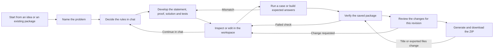

# Experience map and product audit

18 November 2026 · Author Studio

## Evidence and scope

**Browser** means observed in the running application. The walkthrough began on
the current local Studio and then used fresh isolated demo storage. A synthetic
weighted-scheduling conversation exercised decisions and artifacts. A separately
seeded sum package exercised real local Run, expected-answer generation, Verify,
package review and ZIP generation. The conversation and package were deliberately
different so the cost of linking existing work was easy to see. Desktop was the
in-app browser at 1280×720. Phone-width checks used 390×844 and 320×760 in the
same browser. **Source** means confirmed in the checked-out code. **Hypothesis**
means a proposed improvement or an audience assumption to validate with setters.

Read the [existing verification record](../author-studio/VERIFICATION.md) for prior
provider, Isolate and archive tests. This audit used the scripted model for chat.
Real-model quality, human success rates and assistive-technology compatibility
remain separate evidence to gather.

## How the work moves

Two durable identities are visible to the implementation, the conversation ID and
the linked package slug. The author experiences one problem. The engine publishes
conversation artifacts with their own validity. The package workflow uses saved
file bytes and review receipts. A local draft is a third state and can exist
while either saved revision changes. Use clear names for all three before offering
anything that transfers, executes or approves them.

## Journey and surface inventory

| Journey | Current touchpoints and evidence | Moments that need care |
| --- | --- | --- |
| Start and configure | Root route, sidebar New problem, example prompts, provider picker, capabilities disclosure, classic settings. Browser and source. | Describe the supported authoring scope before the first send. Keep a manual path for imported packages and no-provider use. Preserve an existing draft when inserting an example. |
| Name and reopen | Header Name/Rename, title dialog, native conversation select, remembered last run and title. Browser. | A title competes with 3 layout buttons, theme, text size and status at narrow widths. Sidebar truncation obscures similar problems. Expose a keyboard and pointer path with immediate saved feedback. |
| Link a judge package | Files → Package setup → create or select → Continue. A named run can claim the existing package title. Browser and [studio.py](../../../author_studio/studio.py). | Preview which package will change, show full names, preserve the selected artifact, and distinguish manual workspace from a durable link. |
| Develop rules | Inline question, actions for endpoint semantics, ordinary chat reply, decision receipt, breadcrumbs in spec/editorial. Browser. | Show why the choice matters, accept alternate wording and preserve unrelated draft text. State what is still open and how a change affects later work. |
| Read a proof or finding | Transcript, Proof, Files, Activity; artifacts, explanation, finding, handoff and validity. Browser. | A quoted counterexample is difficult to copy. A current approach note can coexist with an open proof obligation. A reader needs the difference and a direct jump. |
| Copy or compare material | Agent artifacts open read-only, Copy to package opens an editable target draft after a package exists. Existing collision and stale-draft guards. Browser and [studio.js](../../../web/studio.js). | Creating/linking a package interrupts the copy. Preserve destination intent, show target role, origin, stale state and actual diff before Save. |
| Navigate and edit | Grouped tree, open files, Monaco, Markdown modes, format/check, dirty mark, base hash, Save. Browser and source. | Duplicate names, dirty closings, reload, currently cached files, real preview contents, and “try again” must protect intent and time. |
| Run and iterate | Choose saved runnable source and stdin → local run → output/details → Run again. Browser. | Keep stdin, source and last result together. Distinguish dirty vs saved, source role, compile vs run, exit vs correctness and expected vs actual. |
| Build and inspect cases | Build tests writes expected outputs for existing inputs. Report lists a subset of cases and mismatches. Browser and source. | Present the actual operation in its label. Lead from failure to case, solution and expected answer. Keep scope-specific secret contents out of copied or sent context by default. |
| Verify and measure limits | Output drawer, saved package verify, tool warnings, freshness stamp, Discuss in chat. Browser and source. | A failed check needs a next step. A run result, measured limits, check pass, proof, and release each mean something different. |
| Review, ZIP and rename | Export ZIP → Verify or Review → Generate ZIP → Download. Shared package workflow and exact snapshot. Browser. | Review shows chronological writes, sometimes repeated paths. The button can approve without opening a diff. Show what changed since review, where title fields changed, and the real filename. |
| Wait, stop, retry and reconnect | Job drawer, status and manual reconnect. Engine inline recovery and package action outcomes. Source and previous repair evidence. | Keep observation vs execution separate, show actual scope and outcome, attach next action to current attempt, preserve user work across ambiguous receipts. |
| Resume or switch contexts | Reload restores the conversation and package link. The UI has in-memory draft/tab models and browser layout settings. Browser and source. | Reopen to the actual place the user was working. Restore a draft as unsaved and compare its base before committing. Keep jobs/receipts in their originating problem. |
| Theme, keyboard, narrow and settings | Light/dark, reading size, pane split, popover, narrow view and classic route. Browser and source. | Keep target size, predictable focus and reading hierarchy. Drawer and tree should give room back to the active task. Settings should be reachable from the point of failure. |

## Baseline findings

| ID | What happened | Evidence type | Consequence |
| --- | --- | --- | --- |
| F01 | Naming before first send worked. After a later rename, the run picker, heading and package label agreed. The export drawer immediately required fresh verification. The rename dialog contained the title field and Save title, with no consequence text. | Browser. [Title regression](../../../qa/engine_contracts/test_api_boundary.py) covers generated statement and ZIP naming. | Keep the one-title behavior. Preview the title and release effect before a linked rename and explain the result afterward. |
| F02 | While copying an editorial, the app asked to link a package. Selecting Workshop Sum Fixture and pressing Continue applied the authoring title to that package. The editor returned with no selected file and no copy dialog. | Browser, supported by [link and title code](../../../author_studio/studio.py). | A generic action changes an existing package and drops the action that started the flow. |
| F03 | Pressing the Half-open decision button with an unsent message in the composer cleared the composer. Finishing another decision showed `Received · superseded` near the input while the author answer and generated artifacts were visible. | Browser. [Composer and receipt source](../../../web/engine.js). | A useful interaction can discard text or tell the author a misleading story about its result. |
| F04 | The synthetic problem and linked package survived reload. The unsent chat, unsaved code edit and open tabs did not reappear. | Browser. In-memory `drafts` and file models in [engine.js](../../../web/engine.js) and [studio.js](../../../web/studio.js). | A normal browser action can lose work and force an author to find their place again. |
| F05 | Chat showed several “Updated … artifact” entries, then a raw handoff with `awaiting_author`, revision terminology and an engine export limit while the screen offered Export ZIP. | Browser. [Desktop handoff capture](evidence/studio-handoff-desktop.jpg). | A setter has to infer what changed, what evidence exists, and which export the app means. |
| F06 | An accepted Python solution ran with input `7 9` and returned `16`. The result showed path, exit, time, output and package revision. The review drawer later showed repeated writes to metadata files. | Browser. | Use a task-oriented Run result and grouped release review while preserving provenance in details. |
| F07 | The 390px page fit its viewport. The file tree kept 105px beside a 285px editor; long paths wrapped across many lines. The header and action row consumed visible vertical space. At 320px the editor measured 214px wide and the header 133px high. | Browser. [Workspace at 390px](evidence/studio-workspace-390.jpg). | Reflow alone leaves narrow code and work controls hard to use. Provide a temporary file picker and let the editor use the width. |
| F08 | The context popup stayed small and labelled usage unavailable, with transcript/artifact counts separately stated. | Browser. | Preserve the honest fallback. A context map needs per-request measurements or labelled estimates before it can describe occupancy. |
| F09 | A package review can record a human-approved snapshot. Individual chronological rows and diffs are the only display for logged changes. For an outside edit with no log entries the viewer gets a short revision stamp and approval action. | Source and [existing browser verification](../author-studio/VERIFICATION.md). | Offer a comparable baseline or a full saved-file review, especially when an outside edit lacks a change receipt. |
| F10 | The file row action list, composer and transcript are rebuilt in several paths. There is no durable browser-level position for an evidence link. Diagnostics remain cached by file until overwritten. | Source. | Verify focus, selections, scroll and diagnostics against actual edits, refresh and navigation before promising semantic improvements. |
| F11 | Fresh setup expects the operator to know the classic settings route. In the clean demo, both example prompts used the same scheduling family and the provider picker exposed only Saved provider. | Browser plus [profile guard](../../../engine/policy.py). | Represent supported work and configuration states in the entry experience. Validate different provider states with fixtures. |
| F12 | The title parser validates a single printable line, and applies an existing LaTeX title command when found. Run identity and slug stay stable. The narrow UI relies on title truncation and conventional Save/Close controls. | Source in [problem_titles.py](../../../author_studio/packages/problem_titles.py) and browser. | Treat legacy/imported PDF, TeX without a title command, duplicates, Unicode filenames and stale open buffers as first-class rename cases. |

The walkthrough was an expert review with synthetic data. It surfaces concrete
failures and design hypotheses. Use author sessions to establish which issues
cost the most time in real contest work.
