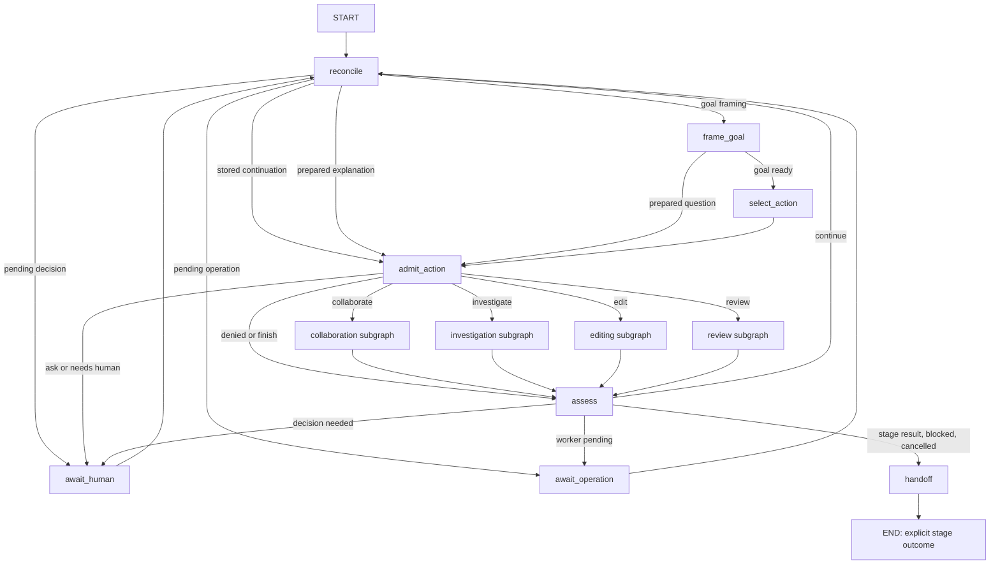

# V0–V3: collaborative ICPC engine implementation

This report records the November 2026 V0–V3 implementation and the executable
acceptance tests for the bounded, single-author engine. The follow-up fixes
cover edit consent, semantic intent, model context, delegation receipts, and
worker status normalization. Raw development records are maintained locally.
[Current roadmap](../../../ROADMAP.md)

This is an implementation report, not a claim of contest readiness, general
mathematical correctness, autonomous model quality, C++ containment or delivery
approval. The deterministic demo uses a **scripted fake model** and a
**simulated worker**; see the capability matrix below.

## 1. What changed and why

The legacy workbench (`agent.py`, `graph_agent.py`, `server.py`, the editor UI)
is preserved. The new profile is additive in `engine/` plus one API surface and
one collaboration panel.

| Seam | Modules | Responsibility |
|---|---|---|
| Policy / input service | `engine/policy.py`, `engine/input_service.py` | canonical paths, capability matrix, barrier classification, idempotent input/response ingress, dispositions and watermark |
| Application ledger | `engine/store.py`, `engine/budget.py` | immutable blobs/revisions, contributions, grants, delegations, operations/receipts, interactions, wakes, attempts, evidence, findings, explanations, handoffs, approvals, projection intents |
| Owner / controller | `engine/owner.py`, `engine/graph.py`, `engine/graph_state.py`, `engine/schemas.py` | OS lock, durable controller epoch, wake outbox, parent `StateGraph` + four scoped subgraphs, validated routing and continuations |
| Isolated diagnostic | `engine/diagnostic.py`, `engine/domain/`, `engine/worker.py` | validator, independently derived subset oracle, finite campaigns, witness/shared-oracle classification, fake and Isolate worker adapters |
| Existing UI | `server.py`, `web/engine.js`, `web/collab.css`, `web/index.html` | minimum active-job composer, decision card, contributions, received vs applied, evidence/explanation, handoff, unsupported-action refusal |

Why: the C2 review found that the previous proposal had unresolved control
ownership, stale-publication, input-ordering, budget and filesystem semantics.
The implementation makes those contracts executable and testable instead of
another design pass.

### Actual graph



Every child has exactly one static edge to `assess`; `assess` has one validated
conditional successor. No node adds both a static successor and
`Command.goto`. The router rejects unknown successors
(`engine/graph_state.py:validate_route`).

Subgraph internals:

| Subgraph | Nodes | Notes |
|---|---|---|
| Collaboration | `retrieve → compose → validate` | 7 COL procedures and resources retrieved on demand; explanations cite only current receipts |
| Investigation | `route_phase → design → qualify → dispatch → interpret` | worker receipt remains durable; interpret reuses the same reservation/operation |
| Editing | `draft → validate_patch → publish` | exact base revision/proposal hash, author edit is revalidated, immutable revision is canonical |
| Review | `brief → challenge → validate_findings` | frozen minimal brief, fabricated citations rejected |

## 2. Gate status

| Gate | Implementation | Evidence status |
|---|---|---|
| V0 contracts/baseline/oracle | complete | deterministic-tested |
| V1 safe effects/author ingress | complete | deterministic-tested + rendered-browser-tested |
| V2 durable joint session/one experiment | complete | deterministic-tested on Windows + restart tests |
| V3 model-directed graph, UI/API, StageReturn | complete | deterministic-tested + rendered-browser-tested with fake model/worker |
| V4 broader domains/mutation/reduction | deferred | not implemented |
| V5 delivery/export and restore mutations | explicitly disabled | V3 denial tests pass |
| V6/V7 qualification/distribution | deferred | not implemented |

The “actual graph must run under fake-model tests” requirement is met: all
acceptance tests invoke the compiled graph and real SQLite application ledger.
`SingleRequestOpenAIAdapter` exists as a narrow seam but no live provider call
was made.

## 3. C01–C12 traceability

All paths are executable tests in `qa/engine_contracts/`:

| ID | Test | Production path exercised |
|---|---|---|
| C01 | `test_v3_acceptance.py::test_c01_*` | `graph.frame_goal`, `admit_action`, `await_human`, `input_service` decisions |
| C02 | `test_c02_*` | `graph.investigation`, `diagnostic`, `domain.oracle_subset`, `collaboration` |
| C03 | `test_c03_*` | `graph.build_collaboration` COL-PROOF claim check, contributions/findings |
| C04 | `test_c04_*`, `test_v1_policy_ingress.py::test_contribution_*` | `input_service`, `store` blobs/contributions |
| C05 | `test_c05_*` | `diagnostic`, `domain` validator, shared-oracle classification, explanation |
| C06 | `test_v2_durability.py::test_input_wins_*`, `test_publication_wins_*` | ingress barrier, `_publication_fence`, `store.invalidate_current_results` |
| C07 | `test_v2_durability.py::test_duplicate_*`, `test_stale_response_*`, `test_silence_*` | idempotency registry, response binding, pending interaction |
| C08 | `test_c08_*`, `test_v2_durability.py::test_deferred_worker_*` | delegation/grant, stage predicate, expiry, host wake |
| C09 | `test_c09_*` (edit/reject/stale binding/patch commit order) | editing draft/validate/publish, proposal hash, approval binding |
| C10 | `test_input_commit_*`, `test_receipt_commit_*`, `test_unknown_*`, `test_c10_two_threads`, API restore refusal | failpoints, restart, epoch, unknown outcome, isolation |
| C11 | `test_c11_*` | depth preference, presentation, no repeated settled question |
| C12 | `test_c12_*`, CR07 explanation-only | COL-EXPLAIN, no unsolicited experiment or approval |

## 4. CR01–CR10 traceability

| ID | Test(s) | Result |
|---|---|---|
| CR01 | `test_cr01_pending_reuses_continuation_and_reservation`; `test_assembled_parent_has_one_router_per_transition` | pass |
| CR02 | `test_cr02_wake_windows` (3 reasons × 4 windows = 12 named schedules) | pass |
| CR03 | `test_later_resolve_supersede_and_cancel_unblock_ambiguity`, `test_explicit_supersede_*`, `test_cancel_precedes_*` | pass |
| CR04 | `test_input_wins_*`, `test_publication_wins_*`, `test_cr04_typed_depth_preference_*`, `test_c09_patch_*order*` | pass |
| CR05 | `test_gateway_transient_then_malformed_then_error_is_exactly_three_attempts`, `test_crash_does_not_reset_budget_or_expiry` | pass |
| CR06 | `test_external_edit_is_never_overwritten`, `test_partial_multi_file_projection_*`, restart/owner tests | pass |
| CR07 | `test_cr07_explanation_only_stops_*`, `test_cr07_reviewed_dp_*` | pass |
| CR08 | `test_fixture_manifest_*`, `test_cr08_actual_dp_base_defect_is_found` | pass |
| CR09 | policy tests, `test_cross_run_blob_reference_rejected`, `test_actor_and_server_owned_fields_rejected`, `test_unsafe_html_*`, API origin/oversize tests | pass |
| CR10 | `test_cr10_stage_return_waits_for_author_and_export_has_no_effect`, API refusal tests | pass |

The finite schedules are recorded by pytest parametrization. This is not a proof
over all interleavings.

## 5. Commands and evidence

Single deterministic suite plus evidence:

```powershell
python scripts/run_v0_v3_suite.py
```

It runs, records exit codes and writes a dated directory under
`docs/implementation/v0-v3/evidence/` (latest verified: 286 deterministic tests
passing, including the CN01-CN15 and CN-R01-R04 chat suites; see `RESULTS.md`):

1. `python -m pytest qa/engine_contracts -q`
2. `python scripts/demo_v0_v3.py --json`
3. `python scripts/capture_engine_identity.py --json`
4. a temporary server with `AUTHOR_AGENT_ENGINE_DEMO=1` +
   `node qa/engine_contracts/browser_smoke.mjs`, `browser_repair.mjs`, plus
   isolated decision/recovery fixture servers running `browser_decision.mjs`
   and `browser_recovery.mjs` if Node and headless Chrome are available
   (`ui-collab.png`, `ui-chat-repair.png`, `ui-chat-decision.png`,
   `ui-chat-recovery.png`, `ui-*.json`)
5. legacy regression scripts (`qa/test_skills.py`, `qa/test_icpc_spec.py`,
   `qa/test_ui_contracts.py`, `qa/test_adversarial_manifest.py`,
   `qa/test_hunks.py`)

Manual/local:

```powershell
python scripts/demo_v0_v3.py          # readable transcript, fake model/worker
python -m pytest qa/engine_contracts -q
$env:AUTHOR_AGENT_ENGINE_DEMO="1"      # explicit labelled demo model/worker
python server.py --port 8787           # UI at http://127.0.0.1:8787/ -> Authoring desk
```

Without `AUTHOR_AGENT_ENGINE_DEMO=1` (and without a configured live model), the
conversation panel explains that no model is configured; it does not substitute
the scripted demo. Configure a model in Settings or set the demo variable.

Decision-model role (optional, local): set `AUTHOR_AGENT_DECISION_MODEL` and
`AUTHOR_AGENT_DECISION_API_KEY` / `AUTHOR_AGENT_DECISION_BASE_URL` to use a
separate lightweight structured-output model. When unset, the configured main
adapter is reused. Demo mode uses the labelled `scripted-decision-demo` adapter.
If no decision model is available outside demo, the turn stays received and
inert with an explanation; the unsafe keyword routes are not used as a silent
substitute. No live provider call is made by the offline suite.

The conversation panel is the primary engine surface: type an idea into the
composer with no files, run selection or fixture choice; answer inline cards in
ordinary language; paste lemmas, tests or solution code; and inspect generated
artifacts from the **Internal artifacts** disclosure. Received vs applied inputs,
durable events and the full typed handoff remain available as optional
inspectors.

The browser journey drives the real panel: opens the disclosure, starts a new
conversation from the composer, answers the inline endpoint card by clicking it,
asserts the derived explanation and artifacts, contributes a lemma, issues a
correction, asks why, inspects an artifact body, asserts the export refusal,
reloads the page, verifies the transcript/card/proof resumed, and continues.
A second journey (`browser_repair.mjs`) covers refusals/questions versus a clear
repair approval, uncertain versus clear semantic answers, proof-help routing,
and stale proof/test/plan inspection after a correction and reload.

## 6. Capability matrix

| Capability | Status |
|---|---|
| Canonical visibility/capability policy and fail-closed paths | implemented, deterministic-tested |
| Bounded contributions, server-owned identity, one idempotent ingress path | implemented, tested |
| Conservative authorization/semantic interpretation with exclusions and clarification | implemented, deterministic-tested; finite contract, not general NL |
| Bounded model context assembly for methods, resources and current-revision contributions | implemented, request-capture tested |
| Isolate protocol normalization for OK/CE/TO/ML/OL/RE/infrastructure/pending | implemented, mocked-transport tested; live qualification pending |
| Durable ledger: blobs, revisions, receipts, wakes, budgets, approvals | implemented, tested |
| Single OS-locked owner, durable epoch, restart reconciliation | implemented, tested on Windows |
| Parent graph + four scoped subgraphs | implemented, tested with scripted model |
| Independent subset oracle and bounded finite campaign | implemented, tested |
| Diagnostic witness, compile/runtime/stale/shared-oracle classification | implemented; fake-worker and worker-unavailable paths tested |
| Worker cancellation (confirmed/unconfirmed) and deadline expiry | implemented; fake-worker acknowledgement and unconfirmed path tested |
| Typed StageReturn (`first_valid_witness`, `campaign_complete`, `explanation_delivered`, `patch_reviewed`) | implemented, tested |
| Patch draft/review/publish with immutable revision and projection intent | implemented, tested (no live file race on WSL) |
| COL-FRAME/COMPARE/PROOF/EXPLAIN/TEST/REPAIR/HANDOFF resources | implemented, retrieval caps tested |
| UI composer, decision card, contributions, received/applied, handoff, refusal | implemented, browser-tested on headless Chrome |
| Conversation-first `ChatService`: automatic run, cards, contributions, artifacts, resume | implemented, CN01-CN15 deterministic + HTTP tested; browser journey tested with demo model/worker |
| Structured decision layer: typed multi-act interpretation, admission, durable replay, configured model role | implemented, CN-R01-R04 + evaluation set tested offline; live-model qualification pending |
| Artifact dependency validity: generation/validity/reason, stale history, state-derived plan | implemented, correction/reload/restart/API tested |
| Decision admission provenance, receipt/publication ordering, budgeted decision calls | implemented, DR01–DR03 deterministic + HTTP + browser tested; live-model evaluation pending |
| Atomic author receipt, guarded revision publication, linked failed-turn recovery | implemented, DR02-A/DR02-B deterministic + HTTP + browser tested |
| Patch diff evidence card and delegation scope inspection | implemented; DOM path not browser-automated |
| Real isolated worker execution | adapter implemented; **unqualified/pending** (no endpoint configured) |
| Real model adapter | seam implemented; **unqualified/pending** (no live call authorized) |
| Delivery/export and restore mutations | **disabled**; API returns 501 with no effects |
| V4 mutation/reduction campaigns, general reducers, AgentDriver, formal proof, broad domain packs, interactive/custom judge, cache/parallel breadth, public hosting, large evaluation | **deferred** |

## 7. Migration and rollback

- New engine state lives in a separate root
  (`AUTHOR_AGENT_ENGINE_ROOT`, default `.author-agent/engine`). Each run has its
  own `runs/<run-id>/app.db` and `checkpoints.db`; legacy workspaces and
  historical evidence are untouched.
- `meta.schema_version` is versioned. A database newer than the build is
  refused rather than reset. There is no destructive migration.
- Rollback a run by stopping the server and preserving/removing that run
  directory; the legacy workbench is unaffected. Copy the two databases before
  upgrading in a future schema.
- Approvals are bound to revision, goal generation, steering epoch and effect
  manifest hash; stale bindings fail (`check_approval_binding`). V3 refuses
  delivery even with an approval.

## 8. Remaining risks and unvalidated claims

1. **Fake worker:** no compiled C++ execution, containment, resource control or
   candidate implementation verification is established by these tests. The
   worker boundary fails closed when no isolate endpoint is configured.
2. **Fake model:** workflow mechanics are tested; model judgment, explanation
   usefulness and false-claim handling by a real model are not qualified.
3. **Platform:** SQLite/lock/projection behaviour is tested on Windows local
   temp paths. WSL bind-mount and Linux durability, and real OS process kills,
   remain to be qualified.
4. **Finite schedules:** 12 wake schedules, commit orders and failpoints are a
   bounded set, not a concurrency proof.
5. **UI:** the rendered check covers the collaboration panel in headless Chrome;
   screen-reader and cross-browser qualification are pending.
6. **Scope:** one blocking interaction at a time, one worker job, no delivery
   and no restore mutations. Human usefulness, independent author study and the
   large provider evaluation are deferred.
7. **Interpretation:** IR01/IR02 use a finite conservative typed interpreter.
   Unseen phrasing outside the tested finite set is not claimed to be
   understood; unclear authority falls back to a concrete authorization card or
   a denial.

## 9. Disclosure

All deterministic tests and the demo use `FakeModelAdapter` (scripted responses)
and `FakeWorker` (a Python simulation keyed by a source marker). The
capabilities endpoint and the panel disclosure state this. They validate
orchestration, authority, persistence and UI mechanics only. They are not a
claim of autonomous successful investigation, compiled-candidate correctness or
worker containment.

