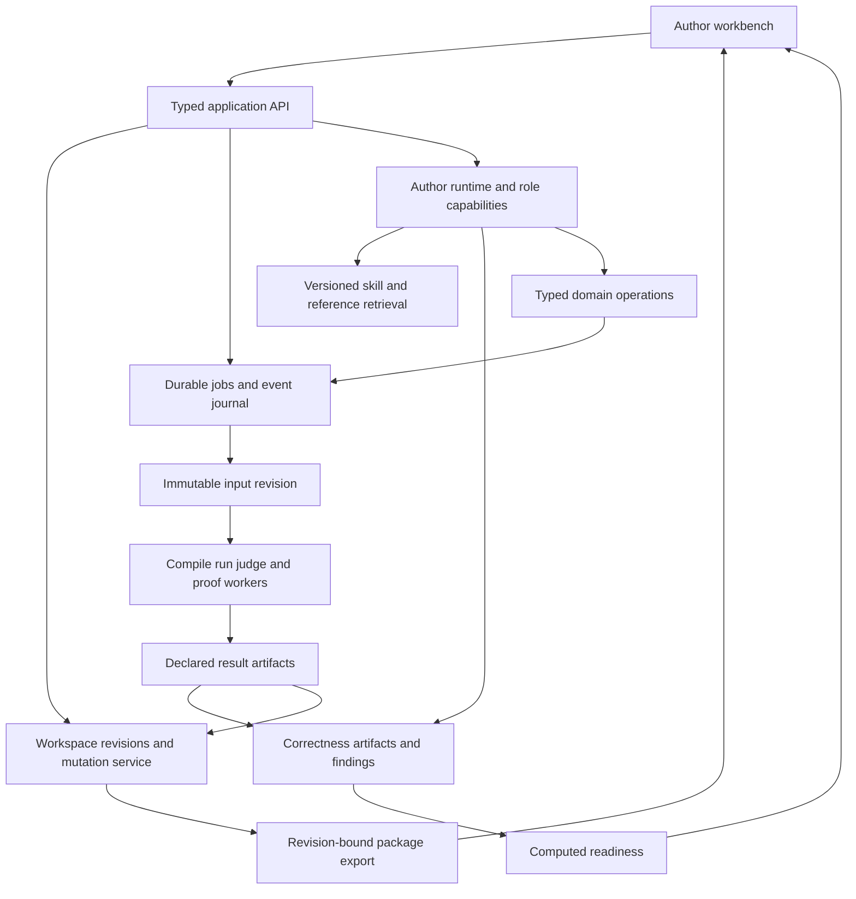

# Target architecture and evidence contracts

Status: proposed implementation design. Keep the existing framework and local
product scope. Extract seams incrementally rather than replace working behavior.

## 1. Product contract

Support the whole problem-setting cycle: idea, specification, algorithm design,
correctness and complexity arguments, implementation, validators/checkers,
generators/tests, adversarial investigation, limits, statement, package review
and export. Support resuming, correcting and backing up the work at any point.

Three outcomes must remain distinct:

- **Package verification:** the selected format and execution checks passed on
  a particular immutable revision.
- **Correctness review:** required obligations have sufficient linked evidence
  and no unresolved blocking findings under the chosen authoring profile.
- **Delivery approval:** the human reviewed and approved that exact revision.

Machine-checked proof is an additional evidence facet with its own proposition
and assumptions. It is never implied by a green package or an LLM review.

## 2. Responsibility boundaries



Suggested incremental module boundaries:

| Boundary | Responsibility | Existing source to split or adapt |
|---|---|---|
| Workspace service | Canonical paths, revisions, compare-and-swap mutations, journal and snapshots | `workspace.py`, mutating server routes |
| Package model/profile | Typed metadata, program selection, format rules and discovery | `package_model.py`, `icpc_spec.py`, `scoring.py` |
| Verification engine | A common lifecycle with mode-specific judging | `verify.py`, `verification_modes.py` |
| Execution protocol/client | Versioned requests/results, capabilities, limits and cancellation | `winutil.py`, `isolate_client.py`, adapters |
| Worker services | Immutable staging, sandbox lifecycle, bounded capture and artifact publication | Both worker modules |
| Agent policy/runtime | Tools, mode/role capabilities, checkpoints, retries and usage | `graph_agent.py`, middleware and state |
| Domain operations | Specification audit, differential search, reducer and mutation analysis | New modules using the execution protocol |
| Evidence service | Obligations, dependencies, findings, review, readiness and invalidation | New typed schema and persistence layer |
| UI feature modules | Transport/jobs, editor, chat, evidence, package actions and settings | `web/app.js`, machines and existing shell |

Do not mandate PostgreSQL, a new frontend framework, a distributed queue or a
different agent framework for the local application. Select storage after a
small migration/recovery spike. Reusing SQLite for metadata/journals is a
reasonable default, but must coexist safely with LangGraph's checkpointer.

## 3. Canonical identity and permissions

Resolve and normalize a path once, then apply policy to canonical identity.
Handle separators, redundant dot segments, Windows case behavior, reserved
names and symlink/junction targets. Deny roots outside the workspace and avoid
time-of-check/time-of-use races. Normalize before both allow and deny checks.

An operation receives a capability object selected by the host: workspace ID,
revision, role, readable roots, writable artifact kinds, execution permissions,
network policy and budgets. Model arguments cannot broaden these capabilities.

The author, reviewer and external MCP client have different needs. Preserve
the chosen default MCP experience for a genuinely new workspace, but make
grants visible and never restore broad grants from damaged consent. Keep
protected tests/answers unavailable through aliases, tool errors, logs,
context snippets, generated-code output and diagnostic reduction.

Diagnostic author-visible cases are separate from protected evaluation data.
Tools may return reproduction inputs only when their provenance permits it.
Reviewers can request executor-produced summaries instead of reading hidden data.

Review mode is enforced by capabilities, not only instructions. Native generated
code execution is disabled unless an explicit developer-only override is chosen.
That override must not be silently enabled by failing worker health checks.

## 4. Revision and execution model

1. Accept a mutation with its expected parent revision.
2. Validate path, policy, content size and schema.
3. Commit file data and journal metadata atomically or with a recoverable intent.
4. Create a content manifest with canonical path, size, type and hash.
5. Derive invalidations from changed dependency identities.
6. Stage a read-only input revision for execution.
7. Run with explicit limits in a disposable directory.
8. Return only declared artifacts and a typed result.
9. Publish artifacts only if the revision/preconditions still match.

Compiler outputs, validator feedback and generated answers have declared
artifact kinds and destinations. A candidate program never receives an entire
mutable author workspace with permission to synchronize arbitrary output back.
Checkers receive the specific test/answer/feedback resources their contract needs.

Use separate policies for source manifests, verifier dependencies, transient
build products and delivered package members. Do not infer semantic importance
from filename suffix alone. Reject escaping links and archive members.

The export operation records the approved source revision, verified revision,
artifact hashes, format profile and exact archive member hashes. Normalize text
only through declared profile transforms. Include the transform/version in
provenance, so archive hashes need not be confused with raw-source hashes.

## 5. Execution protocol

Every request includes protocol version, run/parent IDs, input revision, operation,
program/artifact references, stdin reference, limits, allowed output artifacts
and cancellation token. Do not serialize provider credentials into worker jobs.

Limits include CPU, wall time, memory, stack, process/thread count, open files,
output bytes, total artifact bytes and individual file size. Separate compile,
validator, checker, solution, interactor and formal-check profiles. Reject
unsupported requested limits rather than silently claiming enforcement.

Results distinguish `completed`, `compile-error`, `wrong-answer`, `runtime-error`,
`time-limit`, `memory-limit`, `output-limit`, `judge-error`, `infrastructure-error`,
`cancelled`, `incomplete` and `unsupported`. A queued response is pending.

Record exit code/signal, CPU and wall measurements with units, memory metric and
scope, compiler/version/flags, worker/image identity, enforced limits, truncated
output flags and artifact references. Byte limits apply while capturing output,
not only when rendering already-buffered strings. Preserve binary stdout where
comparators require it. Never classify an infrastructure error as a mutant kill.

Worker capability/health reports must establish toolchains and supported
controls. Application-host `shutil.which` is not proof of remote capabilities.
Pass deadlines across all child operations. Cancellation must terminate the
active process tree and prevent late publication after the user sees cancellation.

## 6. Correctness evidence model

Versioned entities:

| Entity | Essential fields |
|---|---|
| Specification | ID, revision, input domain, output predicate/objective, constraints, semantics, provenance |
| Approach | ID, assumptions, algorithm, applicability, alternatives, source references |
| Obligation | ID, claim, assumption/dependency IDs, kind, argument artifact, status, reviewers |
| Implementation map | Obligation ID, source hash, symbols/lines, numeric/indexing details, known gaps |
| Evidence run | ID, operation/version, inputs/hashes, domain/seed, budgets, result, environment, artifact refs |
| Counterexample | ID, permitted input reference, validity evidence, violated claim, original/reduced witness, reproduction |
| Coverage cell | Requirement/defect ID, representative tests, evidence, missing cases and rationale |
| Finding | ID, role, severity, affected claim/revision, evidence, recommended next check, disposition |
| Review/approval | Human/agent identity type, scope, revision, timestamp, decision and evidence refs |

Status is multi-dimensional. A claim can have bounded test agreement and an open
reasoning gap at the same time. Keep assumption changes visible and invalidate
the affected transitive dependencies. Do not erase superseded arguments/results.

Example conceptual record, not a current file format:

```yaml
schema_version: 1
id: obligation.greedy.exchange
claim: Replacing the first chosen interval by an earliest-finishing interval preserves an optimum.
assumptions: [spec.half_open_intervals, spec.maximum_cardinality]
dependencies: [artifact.specification, artifact.greedy_algorithm]
argument: artifact.editorial.exchange
implementation: [artifact.reference.choose_next]
evidence: [run.small_subset_enumeration]
review:
  reasoning: unresolved
  bounded_testing: tested-within-bounds
  formal_checking: not-requested
blocking_findings: [finding.tie_semantics]
```

The specification itself needs review. Proving the wrong formalization does not
justify the intended problem. A proof of mathematical pseudocode does not
automatically prove C++ overflow behavior or the delivered binary.

## 7. Domain workflow

Stages: scope/clarify, specify, derive, justify, implement, challenge, verify,
review and deliver. Stages permit evidence-driven return paths.

- A counterexample reopens the affected claim and downstream evidence.
- An invalid test is a test defect, not evidence against a correct algorithm.
- A checker failure is a judge defect, not an accepted-solution failure.
- A surviving negative requires investigation before removal/reclassification.
- A correct alternate solution updates the approach catalog and difficulty review.
- Ambiguous semantics pause dependent work while independent checks continue.
- Budget exhaustion records incomplete evidence and the next useful check.

Persist assumptions, editorial arguments and concise decision records. Do not
require an unrestricted internal reasoning transcript from the model. The useful
outputs are inspectable arguments and reproducible evidence.

## 8. Agent and prompt contracts

Retain progressive disclosure. The base prompt holds authority rules, evidence
labels and navigation. Stage prompts provide concrete inputs/outputs, decision
branches, tool prerequisites and completion rules. Skills provide the method
and retrieve examples as needed. No prompt grants new permissions.

A review brief includes the exact revision, specific claim, permitted artifact
manifest, unresolved assumptions, relevant execution summaries, expected finding
schema and limits. Reviewer results cannot approve themselves or overwrite
deterministic verdicts. Review diversity is recorded, not assumed from role names.

Attribute every model/tool event to its run, parent, role and model. Account for
summarization, retries, fallback and specialist calls. If usage is missing or
ambiguous, record unknown rather than invent a cost. Prices need a source/date
and model mapping. Task-wide budgets apply to the entire tree of calls.

Validate required prompt sections at startup. Version/hash the prompt bundle,
active skills, retrieved references and model configuration in evaluation records.
Support two active skills only if that invariant survives concurrent updates.

## 9. Author experience

Keep the current workbench shell, editor and accessible dialogs. Add:

- A readable specification and constraints view with unresolved semantics.
- An argument view with obligation dependencies and source links.
- An evidence view for differential runs, counterexamples, mutation coverage
  and checker matrices.
- A finding queue with acknowledge, repair, dispute-with-evidence and human
  resolution actions, all bound to revisions.
- Separate package, correctness-review and export readiness summaries.
- Clear cancelled/partial/stale/unsupported states and explicit skipped checks.
- Preview of exact approval effects and artifact changes.
- Structured restore preview showing files, conversation state and retained history.

The UI must explain a blocking condition in author terms. Protocol details belong
in expandable diagnostics. Sample judging uses server semantics. Quick runs stay
visibly separate from package verification. Render specialist outputs as findings
and artifacts, not raw JSON or an indistinguishable final author answer.

## 10. Selective formal proof

Begin with one small algorithm and a declared formal specification. Choose a
checker after a bounded toolchain spike. Lean is one candidate, not a universal
requirement. Record theorem statement, axioms, library/tool versions, admissions,
limits, environment and connection to the implementation. Reject unexpected
admitted claims or unapproved assumptions in the selected proof profile.

Accepting a proof and rejecting a deliberately damaged proof are minimum
checks. Also test a valid proof of the wrong specification and require the
product to disclose the mismatch. No promise of formalizing every ICPC problem,
proving asymptotic complexity mechanically or verifying every supported language.
