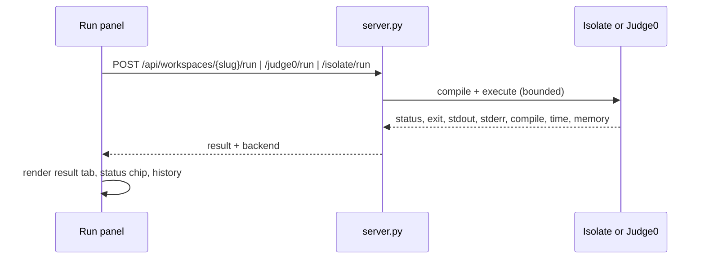

# Architecture

This document describes the target implementation. It is deliberately
framework-level rather than pixel-level: the exact spacing can change without
changing the contracts here.

## 1. Region model

```text
┌──────────────────────────────────────────────────────────────────────────────┐
│ topbar: problem switcher · status · Verify · Export · Settings              │
├──────┬────────────────────┬─────────────────────────────────┬────────────────┤
│ rail │ navigator          │ editor group                    │ agent panel    │
│ 48px │ 260–320px          │ minmax(0, 1fr)                  │ 360–440px      │
│      │                    │                                 │                │
│ Chat │ conversations      │ tab bar · breadcrumbs           │ header         │
│ Files│ file tree          │ Monaco / diff / report          │ transcript     │
│ Rev. │ review queue       │                                 │ approval card  │
│ Run  │ recent runs        │─────────────────────────────────│ composer       │
│ Evid.│ evidence summary   │ run panel: backend · I/O · tests│ (sticky)       │
│ Hist.│ checkpoints        │                                 │                │
├──────┴────────────────────┴─────────────────────────────────┴────────────────┤
│ statusbar: Judge0 ● Isolate ● Executor ● · limits · cursor · verification   │
└──────────────────────────────────────────────────────────────────────────────┘
```

CSS contract:

```css
.layout {
  display: grid;
  grid-template-columns:
    48px
    var(--nav-width, 280px)
    minmax(0, 1fr)
    var(--agent-width, 400px);
  grid-template-rows: minmax(0, 1fr);
  min-height: 0;
  overflow: hidden;
}
.activity-rail,
.navigator,
.editor-group,
.agent-panel {
  min-width: 0;
  min-height: 0;
  overflow: hidden;
}
```

Only the intended inner element scrolls in each region:

| Region | Scroller |
|---|---|
| navigator | the active panel body |
| editor group | editor / report / diff body |
| agent panel | transcript only |
| run panel | output/log body |

No region may rely on `min-height: auto` to size a scroller.

## 2. DOM migration

Keep existing IDs so feature code continues to work. Move nodes; do not rewrite
handlers.

### Activity rail

New:

```html
<nav class="activity-rail" aria-label="Workspace sections">
  <button data-activity="chats" aria-label="Conversations">…</button>
  <button data-activity="files" aria-label="Files">…</button>
  <button data-activity="changes" aria-label="Review">…</button>
  <button data-activity="run" aria-label="Run history">…</button>
  <button data-activity="evidence" aria-label="Evidence">…</button>
  <button data-activity="history" aria-label="History">…</button>
</nav>
```

`switchActivity(section)` maps to `switchSide()` for chats/files/changes and to
the appropriate editor/navigator view for run/evidence/history.

### Navigator

Reuse `.left` and its children. Add a `data-region="navigator"` attribute and
keep `#problem-card`, `.side-tabs`, `#side-chats`, `#side-files`,
`#side-changes`.

### Editor group

Move the current `.right` inspector into the centre. Keep:

- `#panel-file` (editor + run panel)
- `#panel-report`
- `#panel-diff`
- `#panel-history`
- `#panel-mcp`
- `#panel-plan`

Add an editor tab bar above them. `switchTab(tab)` remains the controller.
Add `data-region="editor"`.

### Agent panel

Move the current `.chat-pane` into the right column. Keep:

- `#chat-title`, `#chat-sub`, `#agent-state`
- `#stage-rail`, `#plan-strip`
- `#messages`
- `.composer`, `#composer`, `#send-btn`
- approval/clarification cards rendered into `#messages`

Add `data-region="agent"`. The transcript is the only scroller.

### Status bar

New `footer.statusbar` with:

- `#connection-dot` for online/offline;
- backend health chips: Judge0, Isolate, Executor;
- `#status-limits`;
- `#status-cursor`;
- `#status-language`;
- `#status-verify`;
- optional token/cost summary.

`setConnection`, `updateEditorChrome`, `setStatus` and summary rendering write
here as well as their current locations.

## 3. State architecture

### Rules

1. Every lifecycle has one machine in `web/machines.js`.
2. Machines are pure transition tables; DOM/fetch effects live at the edge.
3. `send(event)` is the only transition path after hydration.
4. `set(state)` is only for server/workspace restore.
5. Illegal events warn in development and return `false`.
6. The DOM mirrors state via `data-state-<id>`.
7. `window.__AUTHOR_AGENT__` holds the latest transition record.
8. UI controls derive from `machine.state`, not from ad-hoc booleans.

### Target machine set

| Machine | States | Primary events |
|---|---|---|
| connection | unknown, online, offline | ONLINE, OFFLINE |
| session | no-workspace, loading, ready, error | LOAD, READY, ERROR, RESET |
| turn | idle, streaming, waiting, cancelling, failed | START, WAIT, RESUME, DONE, FAIL, CANCEL |
| approval | none, pending, resolved | ASK, RESOLVE, CLEAR |
| editor | empty, view, editing, saving, binary | OPEN, EDIT, SAVE, SAVED, FAIL, CANCEL, CLOSE |
| fileLoad | none, loading, loaded, stale, error | LOAD, READY, STALE, ERROR |
| run | hidden, ready, running, passed, failed | READY, RUN, PASS, FAIL, CANCEL, HIDE |
| chat | no-chat, loading, loaded, error | SELECT, NEW, RENAME, DELETE, LOAD, ERROR |
| verification | unverified, verifying, verified, failed, stale | VERIFY, PASS, FAIL, STALE, RESET |
| changes | clean, unreviewed, reviewing, reverted, conflict | CHANGE, REVIEW, REVERT, CONFLICT, CLEAR |
| mcp | disabled, enabled, dirty, saving, probing, error | GRANT, REVOKE, SAVE, PROBE, ERROR |
| settings | clean, dirty, saving, saved, error | EDIT, SAVE, SAVED, ERROR, RESET |
| modal | closed, open | OPEN, CLOSE |
| mentions | hidden, open, filtered, picked | TRIGGER, FILTER, PICK, CLOSE |
| follow | following, paused | PAUSE, FOLLOW |
| tree | collapsed, expanded, selected | TOGGLE, SELECT, REFRESH |
| tests | empty, running, pass, fail | RUN, PASS, FAIL, SELECT |
| restore | idle, confirming, restoring, done, error | ASK, RESTORE, DONE, ERROR |

### Migration order

1. Chat selection + file load.
2. Verification/export + changes/review.
3. MCP/settings/mentions/follow/tests/restore.

Each migration removes the old fields in the same PR and adds a transition test.
Do not keep two writers “for safety”; that reintroduces the bug.

### AX mirror

```js
document.body.dataset.stateTurn;      // "streaming"
document.body.dataset.stateEditor;    // "editing"
document.body.dataset.panel;          // "file"
document.body.dataset.side;           // "files"
window.AuthorMachines.snapshot();     // { turn: "streaming", ... }
window.__AUTHOR_AGENT__.machines;     // { state, previous, event, at }
```

This is the automation contract. Do not rename it without a migration note.

## 4. Editor architecture

### Monaco

- Vendor `monaco-editor@0.44.0` under `web/vendor/monaco/vs` using the AMD
  loader, as Judge0 IDE does.
- Inject `loader.js` on the first edit (view mode stays highlight.js and does
  not pay the 12 MB cost); show a lightweight skeleton while loading.
- Keep one model per open tab, keyed by workspace path, and an `#editor-tabs`
  bar with dirty dots, close buttons and `Ctrl+Tab`/`Ctrl+W`.
- Preserve view state (`cursor`, `scrollTop`, `selection`, mode) per path.
- Dispose models/editors when the workspace changes.
- Use `monaco.editor.createDiffEditor` for the side-by-side diff; keep the
  inline diff and hunk tools as the default.
- Use the same-origin `web/monaco-worker.js` entry point and
  `MonacoEnvironment.getWorkerUrl`. The CSP is
  `script-src 'self' 'unsafe-eval'; worker-src 'self'` because the AMD loader
  compiles module factories; no remote script host is allowed.
- If workers fail, Monaco may fall back internally; if the loader/module
  fails, use the textarea fallback (`?editor=textarea` forces it).

### Fallback

If Monaco fails to load or is disabled:

- keep the current textarea + highlight.js view;
- keep the same tab/dirty/save contract;
- log a single diagnostic to the console and a toast;
- do not block file viewing.

### Tabs

- Tab identity = workspace path.
- Dirty dot from the editor machine.
- Close button + middle-click close.
- `Ctrl+Tab` cycles; `Ctrl+W` closes the active tab.
- Closing a dirty tab asks through the action dialog.
- Tabs survive navigator/agent panel changes.

### Files

- File tree uses `role="tree"`, `role="treeitem"`, `aria-expanded`,
  `aria-selected`.
- Arrow keys move; Right expands; Left collapses; Enter opens.
- Changed files show a dot with a text label in the accessible name.

## 5. Run and Judge0 architecture

### Backend model

```text
BackendSelector: Isolate | Judge0 | Local
```

- **Isolate** — default; deterministic executor; not the verification authority
  by itself, but the verifier uses it.
- **Judge0** — quick-run only; never marks verified.
- **Local** — bwrap fallback; same quick-run semantics.

### Run request flow



### Result model

```ts
type RunResult = {
  backend: "isolate" | "judge0" | "local";
  ok: boolean;
  status: string;        // OK, RE, TO, CE, WA, ...
  exitCode: number | null;
  stdout: string;
  stderr: string;
  compileOutput: string;
  timeMs: number;
  memoryKb: number;
  diagnostic?: string;
};
```

### Guards

- Never send `data/secret/**` or `**/*.ans` to Judge0.
- Only the open file is sent, not the whole workspace.
- Cap output (existing 4 MiB worker cap) and truncate the UI.
- Cancel in-flight requests when the file/tab changes.
- Persist backend + stdin per file, not globally.
- Show “Quick run is not verification” next to the selector.

### Run history

- Last 10 runs per file.
- Store backend, timestamp, status, time, memory, and an output hash.
- “Compare with previous” opens a diff of stdout/stderr.

## 6. Evidence and review architecture

- `#panel-report` becomes an editor tab with grouped checks.
- `#panel-diff` becomes a diff tab keyed by change id.
- `#panel-history` becomes a navigator view; restore opens the action dialog.
- `export-btn.disabled` is derived from a selector:

```js
canExport = verification.state === "verified"
  && !summary.stale
  && changes.unreviewed === 0;
```

- No handler sets `export-btn.disabled` directly.

## 7. Accessibility architecture

### Landmarks

```html
<header>        top bar
<nav>           activity rail
<aside>         navigator
<main>          editor group
<aside>         agent panel
<footer>        status bar
```

Add a skip link to `#editor-group` and `#composer`.

### Focus order

1. Skip link.
2. Top bar actions.
3. Activity rail.
4. Navigator.
5. Editor tabs → editor → run panel.
6. Agent panel header → transcript → composer.

### Keyboard map

```text
Ctrl+K          quick open
Ctrl+Shift+P    command palette
Ctrl+Enter      send message
Ctrl+S          save file
Ctrl+`          toggle run panel
F8 / Shift+F8   next/previous problem
Alt+1/2/3       focus navigator/editor/agent
Ctrl+Tab        next editor tab
Ctrl+W          close editor tab
Escape          close menu/dialog; stop mention menu
```

### Dialogs

- One action dialog grammar.
- `aria-labelledby` / `aria-describedby`.
- Inline `role="alert"` error.
- Cancel / Escape / backdrop close.
- Focus returns to the invoker or the composer fallback.
- Destructive actions use danger styling and explicit object/consequence text.

### Live regions

- Agent stream: polite, throttled; do not announce every token.
- Job state: `role="status"`.
- Run result: `role="status"` with a concise summary.
- Toasts: `role="status" aria-live="polite"`.

## 8. Performance budgets

| Budget | Target |
|---|---|
| Editor interactive (warm) | < 2 s |
| Layout shift on run start | 0 |
| Transcript append | < 16 ms/frame |
| Run panel render | < 50 ms for 1 MB output |
| 30-iteration DOM soak | no unbounded growth |
| 100-test verifier | < 15 min |

## 9. Security boundaries

- No provider key in executor/isolate containers.
- No external network from executors.
- Workspaces isolated per run; cross-workspace absolute paths blocked.
- Judge0 receives only the open file and stdin.
- `data/secret` and `.ans` blocked in the client and the server adapter.
- Output capped; process tree reaped on timeout.
- No secret values in screenshots, docs, tests or logs.

## 10. File-level change map

| Area | Files |
|---|---|
| shell/regions | `web/index.html`, `web/style.css` |
| controllers | `web/app.js` |
| state | `web/machines.js`, `qa/test_state_machines.mjs` |
| editor | `web/vendor/monaco/**`, `web/app.js`, `web/style.css` |
| run/Judge0 | `web/index.html`, `web/app.js`, `judge0_adapter.py`, `server.py` |
| evidence/review | `web/app.js`, `web/style.css`, `verify.py` (read-only) |
| accessibility | `web/index.html`, `qa/accessibility_*.ps1`, `qa/test_accessibility.py` |
| tests | `qa/layout_regression.ps1`, `qa/cdp_workflow.ps1`, `qa/test_ui_contracts.py` |
| docs | `docs/plans/ui-ux-ax-rework/**`, `docs/IMPLEMENTATION-STATUS.md` |

## 11. What not to do

- Do not add a frontend framework or bundler for this rework.
- Do not iframe `judge0/ide` as the primary editor.
- Do not move backend verification into Judge0.
- Do not delete existing tests to make a redesign pass.
- Do not rewrite `app.js` into modules in the same PR as the shell move.
- Do not hide the composer, run panel or tabs behind hover-only affordances.
- Do not use native `prompt`/`confirm`.
- Do not use colour alone for status.
