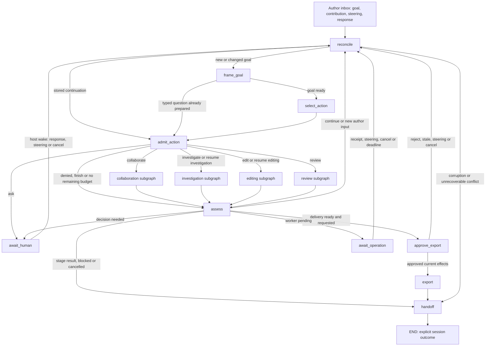

# Target engine design

Date: 2026-11-13. Everything below is **proposed**, except explicit references to current code. This is a concrete design contract, not a claim that these modules or tools exist.

Revision C2 (critical review): human collaboration is part of this architecture and its first slice. [08](08-HUMAN-COLLABORATION-AND-GRAPH.md) supplies the framework adoption and requirement/test map, not an alternate architecture.

## 1. Control and data flow



The model owns investigation choice: which hypothesis to challenge, which oracle/domain is appropriate, whether evidence suggests a semantic or implementation defect, which candidate repair to propose, and when a specialist might help. It records a concise rationale and expected information gain, not unrestricted private reasoning. Code owns authorization, data visibility, validated effect execution, result classification, evidence freshness, budget consumption and whether a claimed stopping condition is satisfied.

The parent is a `StateGraph` with explicit input/output schemas. Its four subgraphs organize methods and effect boundaries, not four additional agents. Use the same model adapter serially by default. A review invocation gets a separate minimal context, not authority over the parent's session. Only the parent commits shared goal/interaction state. Each child returns a validated result envelope through a projection adapter instead of sharing every parent key. Compile children with inherited parent checkpoint support and stable invocation namespaces; do not give disposable child contexts independent permanent conversation memory.

All labelled alternatives from a node are one exhaustive conditional router, not independent static edges. In particular every child returns through assess; investigation never also schedules await_operation. Conditional edges route only validated enums. `select_action` suggests `collaborate|investigate|edit|review|ask|finish`; `admit_action` checks scope, generation, budget and preconditions and chooses the actual route. `Command(update=..., goto=...)` is reserved for validated control transitions; do not add a static successor as well and accidentally execute both. `Command(resume=...)` is not an authorization API: validated responses enter through the interaction service first.

Two routes for the same goal, “find the best booking schedule”: (A) unresolved endpoint semantics -> joint framing -> semantic interrupt -> author's greedy alternative -> discriminator -> explanation -> joint DP proof -> edit. (B) approved specification and supplied reviewed DP -> validate human code contribution -> targeted correspondence test -> bounded stage handoff. Neither route forces a redundant approach discussion. A surprising mismatch in B returns to collaboration/investigation, not straight to export. [Subgraph mechanisms](https://docs.langchain.com/oss/python/langgraph/use-subgraphs)

Each selected action includes `intent`, `target_claim_ids`, `expected_observation`, `args`, `requested_budget` and `on_failure`. The host independently checks the tool schema and prerequisites. `on_failure` is an advisory plan, not authority to bypass a failure. Limit malformed-action repairs to the remaining attempts of its three-attempt deliberation allowance, then return `blocked:model_contract`.

### Node and subgraph contracts

Contract notation: `Ctx` = run, revision, goal generation, input sequence, capability, remaining budget and evidence view. `Plan` = validated action plus targets, discriminator and return condition. `Result` = outcome, new artifact/finding refs, consumed generation and explanation/interaction proposal. All inputs are runtime-validated at API and effect boundaries. Nodes read only the specified projection. Parent writes below are performed by the host, even where content is model-proposed.

Execution classes apply to **every row**: **D** deterministic service node, 5-second local transaction timeout, no blanket retry; retry only an identified busy/read transient at most twice within deadline. **M** one initial model attempt, 90-second attempt deadline, at most two additional attempts TOTAL across transport retries and schema repair, charged to the same run budget. **J** isolated operation, normally 60-second campaign wall/256 MiB with explicit job receipt and cancellation, no blind retry. **H** human wait, no model calls, no response timeout interpreted as consent. **P** publication, D limits plus operation receipt and expected-generation/revision compare-and-swap. These defaults remain proposed and configurable below the delegated/run ceiling.

| Parent node | Purpose and input -> output; state writes | Capability/effects/replay | Route / interrupt / execution class |
|---|---|---|---|
| `reconcile` | Inbox+checkpoint+receipts -> Ctx; advance applied sequence, revision, cancellation epoch, current interaction refs | Journal read/transaction, idempotent input ID; never replay an acknowledged effect | stored continuation -> admit_action; otherwise frame_goal; corruption -> handoff; D, no model |
| `frame_goal` | Ctx+author intent -> GoalProposal; writes goal/decision refs only after validation | Read allowed evidence, propose interpretation, no file effects; persisted proposal ID avoids repeated call after commit | select_action if ready, or prepared question directly to admit_action; M only if interpretation needed, otherwise D |
| `select_action` | Ctx+goal -> Plan; writes proposed action ref | No execution authority; reuse saved proposal on replay, re-evaluate on newer generation | admit_action; M; no direct interrupt |
| `admit_action` | Plan+grant -> admitted child request or denial; writes reservation/operation IDs | Policy/ledger only, transactional reservation | one child, await_human or assess (including denial/finish); D |
| `assess` | Result+latest inbox/receipts -> next status; writes findings/readiness/current refs | Validate evidence and freshness, no model declaration of readiness | exactly one of reconcile, await_human, await_operation, handoff or approve_export; D; interpretation stays in child |
| `await_human` | Persisted Interaction -> consumed Wake ref; records consumption, never duplicates API response receipt | One stable interaction ID persisted before pause; duplicate resumes return existing receipt | dynamic interrupt accepts host Wake envelope only, then reconcile; H, no effect before validation |
| `await_operation` | Pending job refs -> wake reason; writes wake event | Host event wait, not a model poll; durable wake ID | dynamic interrupt with host Wake envelope and worker/deadline/steering reasons, then reconcile; H wait with J deadline; human cannot forge job receipt |
| `approve_export` | Current readiness+manifest -> Approval ref | Human-only approval, exact revision/generation/effects; replay requires current binding | host Wake interrupt; current approved response -> export, reject/stale/steering/cancel -> reconcile; H |
| `export` | Valid Approval+manifest -> export receipt | P; frozen inputs, one publication per operation key | handoff; failures -> incomplete handoff, never unverified export |
| `handoff` | Stage/result/blockers -> Handoff artifact; writes outcome and resumption refs | Deterministic summary projection, optional M explanation only within budget; persisted artifact reused | END with `stage_returned|awaiting_author|incomplete|blocked|cancelled|delivery_complete`; never infers full completion from stage finish |

Each subgraph uses its own input/output types derived from the following rows and the shared Ctx. Shared return statuses are `complete|needs_human|pending|conflict|incomplete|failed`. Only these statuses escape a child; exceptions are classified and routed to parent assess/reconcile. User interrupts are centralized in the parent, so internal child calls do not create competing approval queues.

| Subgraph and internal node | Input -> output / local state writes | Capabilities, side effects and replay | Routing, budget, interrupt behavior |
|---|---|---|---|
| Collaboration `retrieve` | HelpRequest(kind, target refs, depth)+Ctx -> evidence view | Allowed read only, D, stable artifact hashes | compose, or needs_human if essential missing input |
| Collaboration `compose` | Evidence view -> Explanation/Options/ProofProposal | M, proposal artifacts only, no automatic truth upgrade; persist draft hash | validate |
| Collaboration `validate` | Draft -> Result with linked claims and interaction proposal | D, check citations, provenance, response type and question redundancy; artifact receipt | parent assess; at most one repair via compose inside the shared three-attempt action ceiling, then incomplete; no local interrupt |
| Investigation `design` | Claim+author alternative+Ctx -> discriminator plan | M or reuse validated plan; read-only inputs | qualify; no repeated model loop |
| Investigation `qualify` | Plan+oracle/input refs -> admissible request or blocker | D, scope/visibility/oracle checks and reuse of admitted reservation | dispatch, or return needs_human/failed; no claim from invalid inputs |
| Investigation `dispatch` | Admissible request -> job ref / existing receipt | J submission, operation ID/request hash dedup | pending -> Result -> assess -> await_operation; existing terminal -> interpret |
| Investigation `interpret` | Receipt+claim -> Result, witness explanation/finding refs | M if diagnosis needed, deterministic classification remains host-owned; may propose reduction as next parent action | parent assess; no edit permission, no hidden witness disclosure |
| Editing `draft` | ChangeBrief+human contribution+Ctx -> PatchProposal with provenance | M or supplied diff validated by D; scratch artifacts only | validate_patch |
| Editing `validate_patch` | Proposal -> effect manifest / rejection | D, expected revision/generation, path/grant and artifact validation | needs_human if grant requires review; otherwise publish; no interrupt locally |
| Editing `publish` | Validated proposal+grant/response receipt -> revision/invalidation Result | P; edited proposal is a new hash, must be revalidated; receipt avoids replay | parent assess; stale -> conflict, no overwrite |
| Review `brief` | Claim/revision+question -> minimal ReviewBrief | D, read-only frozen visibility manifest | challenge |
| Review `challenge` | Brief -> structured findings and coverage | M, at most 3 total attempts/120 seconds per review including all repairs/retries, tool reads only; no approval | validate_findings |
| Review `validate_findings` | Draft -> Result | D, citation/schema/provenance check, finding IDs dedup; no evidence conclusions by vote | parent assess; one repair within that same review cap, else incomplete |

Editing after human response re-enters via reconciliation and loads the stored proposal; it does not regenerate a different patch under an old approval. Every child checks generation before starting another call and before publication. Durable model-call responses may still incur duplicate provider billing in an unknown-outcome crash window; receipts guarantee idempotent committed effects, not exactly-once inference.

### Executable routing and continuation rules

`assess` uses this precedence: cancellation/revoked scope -> cancelled handoff; unreconciled steering -> reconcile; fatal corruption/unknown required outcome -> blocked handoff; needs_human -> await_human; pending worker -> await_operation; conflict -> reconcile once against new context; incomplete/failed -> incomplete handoff unless a distinct admitted recovery action exists; complete -> evaluate the stage return predicate before considering more work or delivery. A completed explanation without a new author goal ends that conversational turn. It does not launch an unsolicited experiment. Model `finish` is a request evaluated by this same host gate, never a shortcut to export.

Persist `Continuation{action_id, child, phase, request_hash, input_revision, goal_generation, epoch, reservation_id, artifact_refs, operation_id?, interaction_id?}` before a child yields. A worker wake loads the receipt into investigation.interpret without selecting/designing/dispatching the same experiment again. A repair response re-enters editing.validate_patch with the stored (possibly user-edited) patch; it never regenerates an approved diff. New semantics supersede that continuation, keep its historical receipts and require a fresh plan. A transport failure retries only its unfinished phase under the existing reservation. `select_action` may include a complete discriminator or explanation request so the child reuses it rather than paying another planning call. Valid interpretation explanations go directly to the UI without a mandatory second collaboration call.

The parent/child boundaries remain useful for capability projection, typed returns and testing. Their small deterministic internals may be ordinary functions composed in the named node; do not create services, queues or model calls merely to match boxes. Seven collaboration procedures are resource sections, not seven agents or mandatory successive steps. V0–V3 runs one active controller and at most one worker job per workspace. No general scheduler, parallel shared-state reducer, AgentDriver implementation or cache is required.

## 2. State and artifact schemas

The schema sketch is intentionally framework-independent. Use Pydantic or equivalent runtime validation in implementation. TypedDict annotations alone do not validate durable records. All IDs are stable strings, times UTC with timezone, hashes SHA-256 of bytes, versions explicit. Store full objects outside the graph, pass IDs and compact summaries through graph state.

```text
RunState v1
  run_id, workspace_id, thread_id, schema_version
  goal_id, scope_profile_id, capability_id
  observed_revision, active_spec_id, active_approach_id
  obligation_ids[], open_finding_ids[], evidence_ids[]
  active_operation_id?, next_action?, checkpoint_generation
  brief_ref?, selected_resource_refs[], active_skill_refs[]
  budget_id, status, stop_reason?, last_event_seq
  continuation_ref?, controller_epoch, stage_contract_ref
  collaboration_ref, goal_generation, applied_author_seq, steering_epoch
  pending_interaction_ids[], contribution_ids[], delegation_id?, branch_id

Revision v1
  id, parent_id?, files[{canonical_path, hash, size, kind, visibility}]
  spec_hash, profile_hash, prompt_bundle_hash, skill_manifest_hash
  compiler_identity?, worker_image_identity?, created_by, created_at

Obligation v1
  id, revision, kind: feasibility|optimality|completeness|termination|complexity|correspondence
  claim, assumption_ids[], dependency_ids[], argument_ref, code_refs[]
  tests: {evidence_ids[], scope_description}
  reasoning: unreviewed|challenged|reviewed
  formal: not_requested|incomplete|checked
  blocking_finding_ids[], freshness: current|stale

Evidence v1
  id, producer_kind: deterministic|model|human|formal_checker
  producer_version, operation_id, input_refs[], dependency_hashes{}
  domain?, seed?, enumeration_order?, budget_requested, usage_observed
  outcome, artifact_refs[], environment_ref, visibility, freshness

Finding v1
  id, claim_id?, revision, origin_role, origin_model?, severity
  allegation, evidence_refs[], suggested_discriminator
  status: open|investigating|repair_proposed|resolved|disputed|superseded
  disposition_reason?, resolution_evidence_refs[], resolver_kind?, supersedes?

Approval v1
  id, human_actor, revision, action_kind, effect_manifest_hash
  evidence_root_hash, goal_generation, steering_epoch, profile_hash
  decision, created_at, invalidated_at?
```

### Collaboration and response schemas (v1)

```text
CollaborationState
  goal_ref, goal_generation, spec_revision, branch_id
  engagement: together|explain_as_we_go|delegated
  explanation_depth: brief|standard|detailed; preference_source
  open_decision_ids[], pending_interaction_ids[], contribution_ids[]
  delegation_id?, last_author_seq, applied_author_seq, handoff_ref?

HumanInteraction
  id, run_id, kind: semantics|approach_choice|proof_challenge|explanation|
                    test_contribution|repair_review|delegation|export_approval
  revision, goal_generation, proposal_hash, affected_claim_ids[]
  prompt_ref, why, option_ids[], recommendation?, evidence_refs[]
  expected_response_schema, dependent_operations[], blocking
  status: proposed|pending|answered|superseded|withdrawn; response_ids[], resolution_response_id?

HumanResponse
  id, interaction_id, actor_id, client_request_id
  expected_revision, expected_goal_generation, expected_proposal_hash
  kind: semantic_choice|approach_preference|claim|contribution|
        request_explanation|edit_proposal|authorize_effect|reject|defer
  payload (tagged schema), received_seq, received_at

AuthorInput
  id, run_id, kind: new_goal|steer|contribute|respond|set_engagement|cancel
  expected_generation, referenced_artifacts[], text_or_payload
  seq, application_status: received|applied|needs_disambiguation|conflict|superseded
  client_request_id, original_hash, resolves_input_id?, interpretation_ref?

Contribution
  id, actor_kind: human|agent|imported; actor_id, source_input_id
  kind: code|lemma|test|idea; original_blob_hash, derived_artifact_refs[]
  revision, claim_ids[], validation_status, attribution, supersedes?

Delegation
  id, goal_generation, objective, permitted_operations[], exclusions[]
  claim_scope[], budget_ceiling, deadline?, return_predicate
  grant_ref, status: active|returned|revoked|exhausted
  return_kind: first_valid_witness|campaign_complete|explanation_delivered|patch_reviewed
  return_target_refs[], required_evidence_kinds[]

Grant
  id, actor_id, source_input_id, run_id, goal_generation
  operation_kinds[], artifact_or_claim_scope[], budget_id, expires_at?, revoked_at?

Explanation
  id, revision, claim_refs[], audience_depth, question
  short_answer, worked_example_ref?, assumption_to_code_links[]
  evidence_refs[], alternatives[], uncertainty, next_author_actions[]

Handoff
  id, goal_generation, revision, last_applied_author_seq
  decisions[], contributions[], completed_work[], open_questions[]
  current_evidence[], invalidations[], remaining_budget, next_actions[]
```

`semantic_choice` changes intended semantics with author authority. `claim` creates an unvalidated assertion even when human-authored. `authorize_effect` grants only its explicit effect/delegation scope, never correctness. An approach preference directs fair investigation but cannot force a false conclusion. Grant derives only from explicit author instruction/current session authority: model-proposed scope can narrow it but never expand operation kinds, artifact scope, budget or expiry. Clarify consequential ambiguity before activating a proposed expanded grant; no extra confirmation is needed for an already explicit authorized scope. Free text is classified into a proposed typed interpretation; ambiguous consequential effects require confirmation, while a clear instruction is recorded directly without asking again. No response means pending, never approval. Explanations may be delivered without requiring acknowledgement.

Tagged response payload contract (all reject extra authority-bearing fields): `semantic_choice={requirement_id, option_id? , definition_text?}` requires exactly one option or definition; `approach_preference={approach_id, rationale?}`; `claim={text, assumption_ids, supporting_refs}`; `contribution={kind, original_blob_ref, target_claim_ids, attribution}`; `request_explanation={target_ref, question, depth?}`; `edit_proposal={base_proposal_hash, replacement_blob_ref, rationale?}`; `authorize_effect={effect_manifest_hash, grant_scope_ref, decision:approve}`; `reject={target_ref, reason?}`; `defer={target_ref, requested_next_step?}`. A rejection of an effect never approves an alternative. Free text enters AuthorInput, then produces a typed interpretation with its original input ID; it cannot be submitted directly as `Command` payload. The service validates option membership, referenced-object visibility, legal state transition and actor scope before recording an applicable response.

Responses use unique `(run_id, client_request_id)` keys. Exact duplicates return the original receipt without reapplication. Different payload under the same key conflicts. Stale revision/generation/proposal returns a typed conflict and current context, with the original contribution preserved unapplied. Nonsemantic preferences may be explicitly rebased by service policy; no silent rebase for semantic decisions or effect grants. Only one active goal writer interprets the inbox. Sequence is arrival order, not a requirement to block control messages behind an unresolved question. The rules below define application order.

### Concurrent steering and restore

The input endpoint remains available while a graph/worker is active. All mutating endpoints share one inbox and idempotency registry keyed by `(workspace_id, run_id, client_request_id)`; the response endpoint is a typed convenience wrapper, not a second write path. Durably record original content, its hash and a wake-outbox entry in one short application transaction before returning success. Exact replay returns the same receipt/status URL; a reused key with different content conflicts. Server allocates IDs, sequence, actor and authority fields. Model/user payloads cannot supply those as trusted values.

Barrier classification must be deterministic BEFORE acknowledgement: structured depth/engagement-only preference and explanation requests do not advance it; every free-text input, code/lemma/test contribution, semantic response, scope change or cancellation conservatively advances the workspace steering epoch. This intentionally pauses possibly unrelated publication until interpretation. A user cannot bypass the barrier by labelling arbitrary text “preference.” Invalid schema, unauthorized or stale-conflict input creates no executable intent; safe original content can be retained as an unapplied contribution. Reject oversized/disallowed uploads before storing them. New contributions are drafts, never automatic edits or oracle truth.

If publication commits before input admission, retain it as old-generation work and invalidate as needed. If admission wins, no old-epoch model proposal, current explanation, evidence attachment, file change or export may publish as current. Raw late receipts and usage may still be durably recorded as historical/quarantined; this is not permission to apply their result. Interpretation may determine the input is nonsemantic and reuse unchanged evidence by an explicit validated continuation rebase to the new epoch, with no repeated model/worker call. A semantic change increments goal_generation and revises the spec; old requests remain historical, and scope expansion needs explicit authority. UI labels late token streams obsolete until the host commits a current Explanation.

Apply ready inputs in arrival order, but unresolved ambiguity is not a queue lock: cancel/revoke always takes precedence; an authenticated cancellation of the same run is accepted despite a stale expected content generation because it grants no new effect scope; a response naming `resolves_input_id` can resolve an earlier ambiguity; a new steering input may explicitly supersede it. Record a terminal disposition for every earlier entry rather than silently skipping it. Ordinary non-control inputs remain received until their dependencies resolve. `applied_author_seq` is the contiguous terminally dispositioned watermark (applied/conflict/superseded); per-input status and barrier, not that watermark alone, determine whether work may proceed. Report later applied cancellation even if that watermark has not yet advanced.

### Single-owner wake and response protocol

Use one local run-owner service, not a distributed queue. A per-workspace OS lock excludes a second controller process; acquiring ownership advances a durable controller_epoch. Every commit checks ownership, expected epoch and generation. HTTP handlers can append inbox records but never invoke the same graph concurrently. Worker results arrive through that owner and are checked against operation identity, not trusted for owning the controller. A stale controller result cannot commit after restart. Workspace switching does not change run ownership.

`Wake{wake_id, run_id, wait_id, reason: response|steering|cancel|worker_receipt|deadline, durable_record_ref}` is constructed by the host from a durable record. All three wait nodes accept this envelope, including a steering/cancel wake at a human/export interrupt. It is not a HumanResponse or approval. The owner checks the current wait/task identity, marks the wake delivered only after observing a checkpoint/consumption record, and always reconciles application records on restart. Duplicate or late wakes are harmless no-ops after consumption; if no interrupt exists yet, the outbox remains pending and the next boundary sees it. Resume-before-pause and crash-after-resume-before-ack are required tests. No external caller can supply raw Command or system wake payloads.

At most one blocking interaction is current in V0–V3. Explanations and options may be nonblocking artifacts and need no interaction row. An answer that asks for explanation or disputes a proposal does NOT settle its semantic/effect decision: record the response event, retain pending status and route to collaboration before reissuing the same unresolved decision with updated context. Only a valid semantic choice or explicit accept/reject/defer disposition closes that decision; defer yields an awaiting-author handoff, not approval. Answers received while paused are recorded once before resume; the wait node consumes their record, not writes another response. Cancellation withdraws pending interactions; goal change supersedes them. `handoff(END)` ends the current invocation, not the authoring session: a new author input starts reconcile with the persisted session IDs after rechecking scope/budget. No empty-input auto-loop after END.

Blocking questions suspend this graph. The UI remains usable for drafts/inspection and input, and the owner can record worker receipts, cancellation and deadlines without model calls. Independent autonomous model work while waiting is deferred. Human silence never authorizes an effect; a delegated expiry can return incomplete while preserving its unanswered question.

Problem claims/decisions/contributions stay in application evidence storage and graph references. Optional remembered engagement preferences require an explicit inspectable save, namespaced per user; no problem lemma is copied into user memory. The V5 restore contract is: conversation-only restore preserves current effects and labels past decisions historical; files-only restore creates a revision and invalidates affected reasoning; coherent restore forks a session with package/evidence references. None reuses an old delegation or approval without checking current scope. Branch replay may reopen a pending question only with its preserved ID/generation and displayed context.

Evidence facets are not a single confidence ladder. A claim can have exhaustive agreement on a stated finite domain and an open proof gap simultaneously. `formal=checked` applies only to the proposition recorded in its checker artifact. Model confidence is advisory, never an approval field.

Durable specification record: input grammar, quantified domain, output predicate/objective, ties/empty/infeasible behavior, numeric bounds, requirement IDs, author decisions and unresolved questions. Approach record: algorithm, preconditions, rejected alternatives and witness IDs. Code reference includes path/hash/symbol plus line span for convenience. Hash is authoritative when lines move.

### Reducer and concurrency rules

- Messages use the framework message reducer. Do not concatenate replayed messages blindly.
- Evidence/finding maps merge by stable ID only when the payload hash matches. Conflicting same-ID payloads fail, rather than last-writer silently winning.
- Decisions are versioned/superseded records, not `operator.add` lists. Replayed clarification IDs do not duplicate state.
- One controller is the writer of the active revision and next action. Read-only reviews may overlap only on a frozen revision after usefulness is demonstrated.
- Skill activation is a host-validated set after all updates. Two simultaneous loads cannot exceed the configured cap. Resource retrieval uses byte/token limits, not arbitrary path reads.
- Budget updates are transactional reservations, never a parallel additive reducer that can overspend.

This applies framework state/reducer mechanisms to the source's E01/E14 gaps. Basic signatures are present in the installed versions; validate the assembled graph offline before introducing provider calls. [Graph API](https://docs.langchain.com/oss/python/langgraph/graph-api)

## 3. Tool boundary and permissions

Tool requests are envelopes around specific domain schemas:

```json
{
  "schema_version": 1,
  "operation_id": "op-017",
  "run_id": "run-01",
  "expected_revision": "rev-12",
  "goal_generation": 4,
  "steering_epoch": 9,
  "controller_epoch": 2,
  "reservation_id": "reservation-017",
  "kind": "differential_search",
  "inputs": {"candidate": "artifact:c12", "oracle": "artifact:o3", "domain": "domain:d4"},
  "budget": {"cases": 10000, "wall_ms": 60000, "memory_mib": 256, "output_bytes": 1048576},
  "publish_kinds": ["campaign_report", "diagnostic_witness"]
}
```

Host supplies the epoch/generation/reservation fields, capability and authenticated workspace identity, never trusts a model-provided `run_id` to select another run. Hash the validated normalized request. Reusing an operation ID with different arguments is a conflict. Schema bounds require positive finite numbers and reject unknown fields. Input references must exist at the expected revision with allowed visibility and compatible toolchain/domain.

Result contains `operation_id`, `request_hash`, `input_revision`, `status`, `classification`, `actual_limits`, `usage`, `artifacts`, `truncation`, `error_code` and `retryability`. Status is `admitted|pending|completed|cancelled|incomplete|failed|outcome_unknown`; classification distinguishes agreement, counterexample, compile error, candidate runtime error, time/memory/output limit, invalid input, oracle error, judge error, infrastructure error and unsupported capability. Only validated terminal results can become evidence.

| Principal | Read | Mutate | Execute | Approve |
|---|---|---|---|---|
| Author engine | Author-visible package and diagnostic evidence | Propose/commit allowed authoring artifacts under granted scope | Typed bounded jobs via worker | Never human review/export approval |
| Review mode / specialist | Explicit frozen artifact manifest | Finding proposals only | No arbitrary code; may request a host-approved diagnostic tool if role contract permits | Never |
| Worker candidate | Own code/runtime and supplied stdin | Disposable scratch only | Assigned binary within limits | Never |
| Checker/oracle worker | Specifically assigned inputs/answers | Declared feedback/scratch | Assigned checker/oracle | Never |
| Human UI | Authorized local workspace views | Revision-checked edits, decisions | Explicit job requests | Exact revision/effects |
| External agent driver | Same capability-limited tool gateway | Same author policy | Same worker boundary | Never by emitting text |

Canonicalize identity, then check root/visibility/role, then open without following an escaping link. For first slice, reject symlinks/junctions in staged package inputs rather than attempt broad portable link support. Resolve filesystem case semantics on Windows. Apply the same policy to UI context selection, MCP, search, reducers, logs and remote quick-run routes. List metadata itself can leak test information, so protected evaluation data must remain wholly outside authoring mounts.

There are three data classes: author-visible diagnostic cases; authored contest secrets/answers accessible to the judge but not model context under the current policy; independent evaluation inputs unavailable to both author and product agent. A reduced witness may be exposed only if derived from author-visible data. For a hidden assessor failure, return only its authorized diagnostic class, then let the agent seek a fresh public witness. Logs and tool errors follow the same policy.

No native fallback for generated code. No provider keys in workers. Network denied for code execution, provider network confined to the model adapter. An allowlisted Python command remains arbitrary Python and is not a protection boundary. Human write review must cover generated-command publication as well as `write_file`.

## 4. Durable execution and recovery

Use **two SQLite databases** per workspace initially: the existing framework checkpoint database and an application database for revisions, operations, evidence, approvals and events. Keep framework internals untouched. Store immutable content blobs by hash and generate an inspectable file checkout. WAL/busy-timeout/backup behavior must be tested on supported local disks and WSL bind mounts, not assumed portable.

No distributed transaction is required between these databases. The application operation journal is authoritative for external effects; graph state points to receipts. A resumable graph action always reconciles its operation ID before attempting work. Checkpoint durability is useful but does not make filesystem or worker effects exactly-once. [Checkpointers](https://docs.langchain.com/oss/python/langgraph/checkpointers)

Publication protocol:

1. Commit operation intent, request hash, expected revision/generation/steering and controller epochs with its single budget reservation. Reconciliation returns that reservation on replay; qualify does not reserve it twice.
2. Stage a manifest of immutable input blobs. Persist worker job identity before dispatch.
3. Worker runs in disposable storage and returns bounded declared artifacts. It cannot sync arbitrary directories.
4. Store bounded raw receipt/output blobs and usage once by operation/attempt ID, even if now stale. Validate them separately. Raw storage cannot mark current evidence or create an applicable file change. Check capability, ownership, all epochs, expected revision and unresolved inbox barriers inside the publication transaction.
5. If current, commit applicable artifact references, new revision if any, invalidations, operation outcome, deduplicated usage settlement and event sequence in one application transaction. If stale/unknown, record that disposition and usage only; retain outputs historically without attaching them as current evidence.
6. Treat the checkout as a projection, not the canonical publication target. Engine edits create an immutable revision/diff; apply to the managed checkout only under its write lock and expected base hashes. A crash leaves a projection intent. If any target differs, stop projection, preserve both versions and require reconciliation; never blindly finish an old projection over a newer edit.
7. Let the graph consume the receipt. Replaying that node returns the same committed result.

Crash before receipt: query worker by job ID. If it cannot answer, mark `outcome_unknown`; rerun only a pure isolated computation with a new attempt record, never blindly replay publication. Crash after receipt but before graph checkpoint: consume receipt, do not rerun. Offline edits: import a new revision after hashing, invalidate dependencies, do not overwrite them with a stale worker result. Corrupt metadata: quarantine and block affected operations, never silently initialize empty “clean” state.

External editors do not participate in the application transaction. Therefore V0–V3 promises safe publication to immutable revision storage and preservation of external file edits, not atomic replacement of arbitrary externally edited working files. The supported write path is the managed UI over a private application-owned projection; merely marking an externally writable directory “managed” is insufficient. Edits by other processes to that private projection are outside the managed-mode guarantee and must fail its integrity check; externally changed files are imported as new contributions/revisions on explicit refresh, before execution/export and on resume. Do not auto-project over an externally writable checkout: leave a reviewable patch until it is placed in managed mode. This scope avoids pretending a SQLite compare-and-swap prevents a filesystem race. Multi-file projection remains pending until every member matches its committed manifest; execution/export reads immutable blobs and never a partially projected tree.

Interrupts occur after persisting a pending request and before an effect. Approval payload includes the exact revision/effect digest. On resume, recheck both, rejecting an old approval if files changed. Node re-execution is expected, so no non-idempotent effect precedes `interrupt`. [Interrupt semantics](https://docs.langchain.com/oss/python/langgraph/interrupts)

Restore creates a branch recording the chosen checkpoint, package revision and evidence root. V2–V3 provides current-session crash resume and read-only historical inspection. V5 adds explicit conversation-only, files-only and coherent-session restore operations after their contracts are qualified; earlier APIs reject restore mutations as unsupported. Do not delete the old checkpoint thread. Restoring files alone does not revive approvals or stale measurements.

## 5. Memory, collaboration and stopping rules

Working memory contains current goal, semantic decisions, open findings, last discriminator, budgets and artifact IDs. Persistent evidence contains actual runs, counterexamples, proof drafts and dependency lineage. Retrieval begins with ID/path/requirement queries over local metadata. No vector database is needed for this corpus initially.

Compaction regenerates a short index from durable records and summarizes only narrative context. It cannot erase an open blocker or convert uncertain evidence to a fact. Keep policy text immutable and separate from selected file contents. Truncation returns explicit ranges and continuation references. Test compaction with contradictory revisions and a hidden-data canary.

One optional reviewer is justified for a distinct challenge, e.g. “find a missing assumption in obligation O3” or “challenge the oracle's independence.” Give it a frozen minimal brief without the author's persuasive conclusion when possible. It returns structured findings, not approval. Record provider/model and shared assumptions. Same-model roles are correlated review attempts. The independent finite oracle and blind human grading provide different evidence. Additional specialists must earn their cost through the reviewer ablation.

| Condition | Host response |
|---|---|
| High-impact semantic ambiguity | Pause dependent steps with 1–3 concrete questions; allow independent inspection |
| Failed hypothesis | Preserve claim and counterexample, mark refuted, choose alternative |
| Surviving negative | Require adjudication: wrong survivor, correct alternative, invalid case, oracle/checker defect, or unresolved |
| Conflicting evidence | Freeze readiness; reproduce both on identical inputs/toolchains and audit oracle/judge before patching candidate |
| Repeated nonprogress | Same action+input hash+outcome twice triggers a new discriminator or explicit incomplete stop |
| Provider refusal | Record refusal, no automatic cross-provider retry to evade refusal |
| Rate limit / transport interruption | Bounded retry under the shared budget, or resumable provider-blocked outcome |
| Changed files | New revision, dependency invalidation, no automatic stale-result publication |
| Budget/cancellation | Persist partial valid evidence and next useful step, never completed success |
| All profile obligations satisfied | `ready_for_human_review`, not approved or mathematically proved |

Two stopping contracts must not be conflated. **StageReturn** in V3 uses the selected typed predicate: first_valid_witness requires a qualified legal input and candidate/oracle receipt; campaign_complete requires declared-domain completion counts; explanation_delivered requires a current Explanation addressing the named question; patch_reviewed requires a current diff and explicit review disposition. User-authored natural-language return conditions are interpreted into one of these contracts, with only consequential ambiguity asked. No arbitrary executable predicates. A diagnostic stage can succeed with an unrepaired bug or open unrelated proof obligation, which the handoff lists. A cancelled/expired/unknown required operation cannot be called stage success. Stage success never permits export or weakens delivery obligations.

**DeliveryReady** is later V5 functionality and remains false/unsupported in the V0–V3 profile. There is no “first-slice export success” shortcut or legacy-profile escape. V3 preserves exact-effect approval records and tests their staleness with synthetic manifests, but the user-facing slice ends with a reviewable diagnosis/patch/handoff. At V5 the delivery profile names required argument, oracle, package, resource and mutation evidence, with independent status for each. A rejected approach witness is conditional on having investigated a refutable alternative, not a demand to manufacture a bad hypothesis for every task.

Readiness predicate is deterministic: supported profile, current package report, required obligations/artifacts present, no unresolved blocking findings, oracle/judge qualification satisfied, no pending/unknown operations, and current evidence dependencies. Human can dispute a finding with reason/evidence, but cannot relabel an infrastructure failure as a successful experiment. Export additionally requires current human approval and matching manifest. An explicit legacy export profile may expose old package-only behavior after integrity repair, with clear missing-correctness-review status, never silently upgrade it.

## 6. Budgets and observability

Proposed development defaults, to calibrate before paid evaluation: 30 model calls per investigation including summaries/reviews, at most 2 combined transport/schema retries within the shared action ceiling, at most 1 specialist invocation of 3 total attempts, 20 minutes active processing (human wait excluded), with any delegated wall-clock expiry enforced independently, 10,000 cases per campaign, 60 seconds campaign wall time, 256 MiB candidate memory, 1 MiB captured output, 10 MiB published artifacts. Large performance tests get a separate explicit budget. Dollar caps are user-provided, not inferred from these illustrative values.

Before frame_goal or select_action makes any model request, the owner reserves a deliberation allowance from the run budget (at most three attempts including repairs); no effect-action reservation exists yet. Replaying a saved decision does not reserve/call again. Admission then creates a separate effect-action reservation for child work, without charging the already-settled decision twice. One admitted action owns one reservation with separate model-attempt/worker/case counters; child phases consume it, never create a duplicate parent reservation. Every outbound inference request counts as an attempt, including schema repair and transport retry. Per admitted action allow at most 3 total model attempts across ALL normal child phases and their retries/repairs (not three per node), additionally limited by any tighter child cap and the remaining run ceiling of 30. No nested RetryPolicy plus adapter retries; the adapter performs a single request and the owner controls the retry count. The review's 120-second wall deadline includes its retries; every attempt timeout is min(90 seconds, action/stage remaining time). A schema repair consumes the next available attempt, not a fresh retry tree. Worker/model usage settlement is unique per attempt; unknown provider usage keeps the conservative reservation, and resume cannot reset it.

Active time includes model requests, retry backoff, worker wait and local processing, but excludes a pure author wait with no running job. Delegation deadline uses durable absolute UTC expiry; it cannot pause for human thought. Crash/restart does not reset accumulated time or expiry. Deadline checks precede resume/admission and every effect commit. If expiry occurs while the app is down, next startup records the expired stage before any new work. Resource failure on the final allowed attempt returns an incomplete handoff with no model-generated summary required.

Reserve the worst permitted next call/tool budget before execution. Count retries, failed parsing, fallback, summaries and specialists. Record reported tokens separately from conservative reservations. If provider usage or prices are absent, cost is **unknown**, not zero. Subscription quotas are not dollar estimates. Exact billing caps cannot be guaranteed by estimates or cancelling an already accepted request; combine call/token caps with provider-side limits where available and disclose overshoot exposure.

Persist events with `(run_id, seq, parent_operation_id, role, model, revision, type, timestamp, payload_ref)`. Role-specific text streams must not overwrite the author's final answer. Distinguish transient deltas, validated model decisions, worker receipts and committed domain events. Reconnect by cursor with gap detection. UI shows current hypothesis, experiment purpose, evidence/result and next action, plus separate package/reasoning/approval facets. Store usage and terminal events even on error. Redact secrets and protected fixtures at event creation, not only when rendering.

## 7. Bring-your-own-access design

Current `_chat_model` constructs ChatOpenAI for a configurable endpoint. This is not a universal provider compatibility contract. Use two small interfaces rather than falsely treating an agent CLI as a model API:

```text
ModelAdapter
  describe_capabilities() -> tools, structured_output, streaming, usage, cancellation
  stream(request, budget_reservation, cancel) -> ModelEvent sequence
  close()

AgentDriver
  start_or_resume(session_ref, brief, tool_gateway, capability, budget) -> AgentEvent sequence
  interrupt(session_ref, turn_ref)
  reconcile(session_ref) -> terminal/pending/unknown
```

Model events: text delta, complete tool call, schema result, usage, terminal, error. Normalize tool-call IDs and stop reasons without discarding provider-native diagnostics. Never execute partial streamed arguments. AgentDriver outputs are proposals/effects through the same gateway and evidence store. It does not run inside a second unrestricted `create_agent` loop.

| Access path | Proposed initial status | Auth and execution | Stream/cancel/usage | Limitation |
|---|---|---|---|---|
| OpenAI official API | First supported model adapter after conformance | User API key, selected documented endpoint/model, host tools | Streaming, transport close, reported usage where returned | Key/billing entitlement separate from chat login; closing transport does not prove billing stopped |
| Existing OpenAI-compatible endpoint | Experimental compatibility adapter | User key/base URL, explicit capability test | Per-endpoint tests required | Do not advertise all providers or assume max context/strict tools |
| Codex local app-server | Optional second-release AgentDriver, conditional qualification | User-owned official sign-in, restricted tool gateway | Protocol events, `turn/interrupt`, token-usage updates | Dynamic tools experimental; local/open-source allowance does not extend to hosted/commercial use |
| Claude Messages API | Later direct adapter | Anthropic API key, native tool conversion | Native streaming/usage, transport cancellation qualified separately | No new SDK dependency needed solely for model calls |
| Claude Agent SDK | Later AgentDriver using API auth | API key or documented cloud provider auth, controlled tools | Async messages, streaming interrupt, result usage/cost | Not a supported claude.ai subscription login for distributed third-party app absent prior approval |
| Personal Claude CLI subscription | Not an initial product integration | User's official CLI may be used separately | Headless facilities exist | Personal automation does not establish permission to package subscription-backed access |

Official OpenAI auth distinguishes ChatGPT subscription sign-in from usage-based API keys. Do not extract tokens or route a subscription credential into ChatOpenAI. [Authentication](https://learn.chatgpt.com/docs/auth)

Codex's documented app-server is appropriate to investigate for this local/open-source scope, but its published distribution restriction and experimental tool surface require a pinned protocol qualification before advertising support. The current guidance explicitly discusses continued use by existing local/open-source integrations; eligibility for this new integration is not established here. Prefer official sign-in flows, never read the user's authentication file. [App-server](https://learn.chatgpt.com/docs/app-server)

Claude's quickstart explicitly restricts third-party claude.ai login/rate-limit use without prior approval. Its Python SDK documents tools, streamed response handling, interrupts and result usage. These justify an API-authenticated later adapter, not subscription entitlement. [Quickstart](https://code.claude.com/docs/en/agent-sdk/quickstart), [Python reference](https://code.claude.com/docs/en/agent-sdk/python)

Conformance fixture matrix for every adapter/version: valid/malformed tool calls, text-only unsupported response, tool+structured-output coexistence, refusal, 429, disconnect before/after complete call, cancellation acknowledgement, missing/duplicate usage, retry/fallback identity, resume, and attempted unauthorized filesystem/exec action. Test doubles first; user-authenticated live checks require later bounded authorization. V3 initially uses a fake ModelAdapter and worker simulator for contracts, then a qualified isolated worker. Before any later live V3 trial, a minimal single-endpoint adapter must pass malformed-tool, disconnect/unknown-usage, cancellation and shared-budget checks; V6 broadens provider/distribution conformance. AgentDriver is an interface sketch for V7, not a first-slice implementation dependency. Installation only probes availability/version and prompts users through official login when they choose it. No service startup or auth discovery occurred during this research.


## 8. Collaboration UI and API contract

This is a focused extension of the current editor/chat, not a new frontend framework. The first slice must show an author input composer while a job is running, a decision card, an editable contribution/proposal panel, a diagnostic evidence card and a resume/handoff panel. Raw tokens are optional supplementary text, never the authoritative progress state.

| Surface / proposed local API | Request and visible response | Required behavior |
|---|---|---|
| `POST /runs/{id}/inputs` | `AuthorInput`, client idempotency key, expected generation; server returns input ID, sequence, status URL and `received` | Works during active job; durable append before acknowledgement. Show received vs applied/conflict separately. Every possibly consequential input establishes barrier before acknowledgement; no long job lock. |
| `POST /runs/{id}/interactions/{iid}/responses` | Tagged `HumanResponse`, expected proposal hash/revision/generation | Validate actor, target, payload and current binding before resume. Shared inbox idempotency key/body returns original receipt; same key/different body -> conflict. Stale response -> conflict with current card and retained original. |
| `GET /runs/{id}/view` | Revision, generation, last applied seq, capabilities, budget, pending decisions, contributions, current explanation/handoff refs | Reconnect snapshot reconciles events; never infer applied state from local text buffer. |
| `GET /runs/{id}/events?after=seq` | Durable domain events, separate transient token channel | Gap -> reload snapshot; dedup by sequence. Render received/applied/superseded, operation started/receipt/unknown, evidence invalidated, stage returned. |
| Contribution panel via inputs | Code/lemma/test original plus actor and intended claim, editable derived proposal | Keep original immutable. Validate uploaded paths/size/schema. Mark unvalidated vs tested vs reasoning-reviewed. Diff and attribution survive agent revision. |
| Decision card via response endpoint | Why needed, linked assumptions, 2–3 options with consequences, recommendation and free response | Never pre-submit recommendation. “Explain,” “edit,” “disagree” and “defer” are distinct actions. Nonblocking preference does not become mandatory approval. |
| Repair panel | Exact diff, affected obligations, witness before/after, remaining uncertainty | An edited diff gets a new hash and validation. Existing scope grant may cover routine edits; otherwise request this concrete effect. Reject leaves source intact and asks next discriminator only if needed. |
| Delegation card via inputs | Objective, allowed operations, exclusions, caps and observable return predicate | Explicit instruction creates grant without redundant confirmation. Ambiguous expanded scope needs a decision. Returning a witness is stage success, not delivery success. |
| Handoff / restore | Decisions, human originals/derived artifacts, open questions, evidence freshness, next action, remaining budget | Resume current branch after reconciliation. V3 history is read-only; V5 restore mutations are distinct choices with visible invalidations. |

V1 endpoints require the local session's actor plus same-origin/CSRF protection for mutations, including localhost; loopback alone is not authorization. Contributions use bounded immutable text blobs (UTF-8, proposed 1 MiB per contribution, 10 MiB total per input), content hashes and server-owned identifiers, with no arbitrary path ingestion or auto-execution. Render explanation/contribution text as escaped content, not trusted HTML. Unknown or cross-run artifact IDs fail visibility checks. These are narrow first-slice ingress requirements, not a multi-user identity platform.

Schema/source of truth: application records own goal, contribution, interaction, grant, revision, input disposition and budget. RunState/CollaborationState contain versioned projections only; one transaction updates canonical records, and reconcile rebuilds the graph view. `goal_generation` changes semantic/scope context; revision changes content; steering_epoch fences not-yet-interpreted input; controller_epoch fences runtime ownership; event_seq orders UI events. None is interchangeable. Future schemas fail closed as unsupported and preserve the original database; migration is copy-before-upgrade and never an automatic empty reset.

Use normal HTTP validation/conflict semantics (422 malformed, 409 stale/key mismatch, 202 received, 200 durable response/replay). These are proposed contracts; existing routes remain migration adapters until covered by the same service. Local authenticated session identity must establish actor identity, not an arbitrary body field. Input content is untrusted task data and cannot change policy.

Progress example: “Testing your earliest-finish proposal against weighted cases; 42/100 completed; source revision R4; your endpoint correction is received and this job's publication is blocked.” After reconciliation: “Half-open semantics applied as generation 3; the old result is historical; the touching-jobs test is next.” A discrepancy card shows `7 vs 12`, the legal two-job input, the violated compatibility definition and the exact comparison in code. It offers “explain the proof,” “review a patch” and “keep investigating,” rather than demanding assent to a model conclusion.

Depth preference changes presentation, not evidence requirements: brief shows conclusion/witness/uncertainty; standard adds assumption-to-code map; detailed adds proof obligation and alternative derivation. A user who states semantics once is not asked again unless a later contradiction changes the dependent choice. If the author rejects adding a redundant third reference to stay within budget, continue with the qualified finite oracle and disclose the reduced scope. If the author asserts earliest finish is optimal for weighted intervals, preserve the claim and refute it with a legal witness; do not mistake agreement preference for mathematical authority.

First-slice limitation: a blocking human decision suspends the graph; the UI remains available for inspection and editing, and workers can settle receipts. Scheduling independent model work while a question waits is deferred. This avoids a second scheduler and keeps the interaction useful without promising concurrent autonomous progress.
